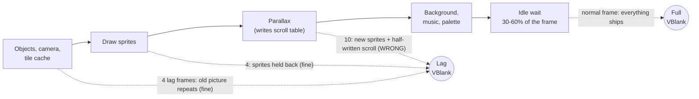

# Frame architecture

**Pilot audit (wave 0).** Also serves as change 5, the whole-frame review.

## Stages (live)

![[Audit stages.base#Frame architecture]]

Then: 5. Lead (Fable) merges into this page; 6. Controller (main session) verifies contested claims
in code, runs live-emulator items, and reports to you.

## Scope

The main loop and game-state dispatch (`engine/system/game_loop.emp`, the sonic4 state in
`games/sonic4/test/ojz_scroll_test.emp`), VBlank and HBlank (`engine/system/vblank.emp`,
`hblank.emp`, `engine/effects/raster.emp`), lag detection and the lag path, `VSync_Wait` idle work
(art decode, page sweep), what is committed to the VDP each frame (`engine/system/buffers.emp`,
`dma_queue.emp`, `vdp_init.emp`), and where sound and input sit in the frame.

**Known going in** (from [[2026-11-13-engine-systems-review]]): lag frames ship the sprite table and
HScroll out of step; solids resolve after the camera; all 19 VDP registers are written every frame;
the plane drain is charged 1:1 against the DMA budget.

## Verdict

> [!verdict] S3K level, uneven
> Both reviewers reached the same verdict independently, and I agree.
> - **At or past the best known:** sound keeps playing through video transfers, the three-priority transfer queue, input that never loses a button press, and a tick counter that makes replays possible.
> - **Below S3K in two places.** When a frame runs late, the screen shows a mix of the new frame and the old one (S3K holds the old picture). And the safety budget for the gap between pictures counts bytes, while the thing that actually runs out is time.
> - **The lag itself is not a frame-design problem.** All 18 measured lag frames come from one routine (the tile cache) spiking on a single tick, while the engine sits idle for 30% to 60% of an average frame.
> - **Reuse:** a 60 Hz shmup fits today with some waste. A 30 Hz game or a split-screen game does not.
>
> Changes 1 to 5 in the plan bring it to best known. One candidate (an all-or-nothing frame publish) would go past anything shipped on the console.

### Terms used on this page

| Term | Meaning |
|---|---|
| Tick | One pass of game logic. Normally one per picture |
| VBlank | The gap between two pictures, about 18,566 CPU cycles on NTSC. Video memory can be written quickly only here |
| Lag frame | A picture that arrives before the tick has finished |
| DMA | The fast copy into video memory. About 2.4 cycles a byte during VBlank, eleven times slower during the picture, and the CPU is frozen while it runs |
| Plane drain | Writing new rows and columns of level tiles to the screen map. Done by a CPU loop today, not by DMA |
| HScroll / sprite table | The per-line scroll positions (896 bytes) and the sprite list (640 bytes), re-sent every frame |

### Where the time goes, and where lag lands

Measured over 9 runs, about 12,000 pictures, 18 lag frames (stage 2).

### What the earlier review said, and what this audit found

| Defect from the 2026-11-13 review | Result | Detail |
|---|---|---|
| Lag frames ship sprites and HScroll out of step | **Confirmed and extended** | Measured on 10 of 18 lag frames. It is worse than recorded: the scroll table itself is half new and half old, and the vertical scroll, raster split lines and palette can be mixed too. Finding 1 |
| Plane drain charged 1:1 | **Confirmed and extended** | Measured at about 8.75 cycles a byte (the review estimated 7.5) against 2.7 charged. The budget also ignores 5,000 to 8,000 cycles of fixed work. Finding 2 |
| All 19 VDP registers written every frame | **Confirmed, but not worth fixing** | It costs 698 cycles (under 4% of VBlank) and is a deliberate choice that lets effects change registers without cleaning up. The real defect is the architecture doc, which says only changed registers are written. Finding 10 |
| Solids resolve after the camera | **Still true in code; neither reviewer examined it** | `TouchResponse` (`ojz_scroll_test.emp:1211`) still runs after `Camera_Update` (`:1117`). Reviewer A was not given the earlier review and B did not pick it up. I confirmed the order only. It needs the collision audit and a live look |

## Findings

Most severe first. "A" is reviewer A (Fable), "B" is reviewer B (Opus). They did not see each other's work.

> [!finding] 1. A lag frame shows a mixed picture
> **What is wrong.** When a tick runs late, the lag handler still sends whatever is ready. If the sprites are finished but the parallax step is not, the screen gets new sprites, a scroll table that is new at the top and old at the bottom, no new level tiles, and no new character art.
> **Why it matters.** Sprites jump 6 to 16 pixels against the ground for one frame. S3K sends neither sprites nor scroll on a lag frame, so this is below the floor. The architecture doc says the player "never sees visual glitches".
> **Evidence.** `vblank.emp:362` and `:456` (the lag path still queues and sends); `buffers.emp:464-473` (sprites sent once drawn); `buffers.emp:505-507` with `parallax.emp:4887` (one scroll buffer, written in place). Stage 2: 10 of 18 lag frames landed inside `Parallax_Update` with the sprite table ready.
> **Found by** both. **Confidence** high (proven in code, measured in occurrence). How it looks on screen is not yet captured.

> [!finding] 2. The VBlank budget does not actually stop an overrun
> **What is wrong.** The budget is 6,144 bytes per VBlank. It assumes every byte costs 2.7 cycles and leaves about 2,000 cycles spare for everything else. Measured, the handler's fixed work costs 5,000 to 7,900 cycles and tile rows cost about 8.75 cycles a byte.
> **Why it matters.** The worst measured VBlank used 97% of the available time while only 58% of the byte budget was spent. A frame that really used the budget would run into the picture. There the copy is eleven times slower with the CPU frozen, so one bad frame becomes several lag frames and the raster effects slip. Nothing has triggered it yet because demand is low: no sidekick, no boss, no streaming act.
> **Evidence.** `engine/system/constants.emp:758-771` (the derivation); `vblank.emp:169-175` (plane charged by byte count). Stage 2: worst VBlank 18,052 of about 18,566 cycles; peak 3,592 B. A's split of the worst call: 6,578 stall + 4,866 plane + 6,184 fixed.
> **Found by** both, with matching arithmetic (a safe budget on a peak frame is about 2.8 to 2.9 KB). **Confidence** high on the mechanism; the overrun itself is ESTIMATED and unobserved. First item on the live-run list.

> [!finding] 3. Every lag frame is one tile-cache spike, with idle time unused
> **What is wrong.** Average logic takes 30% to 56% of a frame. The worst tick took 154%, and in every case the spike is `Tile_Cache_Fill` (up to 109,602 cycles in one call). Meanwhile the main loop waits idle for 40,000 to 79,000 cycles on an average tick. Nothing in the main loop checks how much of the frame is left before starting more work.
> **Why it matters.** Lag only happens when the camera moves on two axes at once, which is exactly what a mega-act does. The idle slot and the pause-and-resume mechanism exist, but only the art decoder uses them.
> **Evidence.** Stage 2, sections a and b. `tile_cache.emp:1575-1577` says a beam-position read cannot measure frame load; both reviewers doubt that comment.
> **Found by** both. **Confidence** high on the measurement. Whether the spike is work that can be postponed is not established; that belongs to the tile-cache audit.

> [!finding] 4. The frame is built around one Sonic level
> **What is wrong.**
> - The scroll table is only sent when a level parallax config is active (`buffers.emp:505-506`). A game that fills the table itself gets nothing on screen.
> - There is one VBlank handler, and it always runs level code. The lag handler cannot be replaced at all (`vblank.emp:87`).
> - A game running logic every second frame loses button presses: each full VBlank overwrites the press byte and clears the accumulator (`vblank.emp:304-311`).
> - The order of work for the shipped game lives in a 4,570-line test file. Nothing states which orders are safe, and that order is what causes finding 1.
>
> **Why it matters.** The engine is meant to be reused. A shmup works today, paying for level steps it does not use. A 30 Hz or split-screen game does not.
> **Found by** B (scroll gate, 30 Hz input), A (test-file order, no frame phases), both (single handler). I confirmed each in code. **Confidence** high.

> [!finding] 5. Game logic reads the picture counter
> **What is wrong.** Flight fuel is spent on odd values of `Frame_Counter`, which counts pictures including lag frames, not ticks (`games/sonic4/player/player_fly.emp:271`; two sound timings at `:430` and `player_glide.emp:691`).
> **Why it matters.** Flight lasts a different time depending on lag. Replays are recorded in DEBUG and played in release, and the two builds lag differently (6 against 2 on the same run), so a replay with flight can drift.
> **Found by** A only. I confirmed it in code. **Confidence** high.

> [!finding] 6. A scroll-mode register is written in the middle of the picture
> **What is wrong.** When the scroll mode changes, `Parallax_Update` writes VDP register `$0B` straight to the hardware from the main loop (`parallax.emp:2025-2051`), wherever the beam happens to be. The scroll data for the new mode is not sent until the next VBlank, and the register would be updated there anyway.
> **Why it matters.** The rest of the picture being drawn uses the new mode with the old data. In the worst pairing the lower part of the screen scrolls vertically by stale values for one frame. It also stops the Z80 briefly.
> **Found by** B only. The code is as described; the comment's reason does not hold up against the frame order. **Confidence** medium: the visible effect rests on reasoning and needs a live check.

> [!finding] 7. The palette can be sent half-built on a lag frame
> **What is wrong.** Two separate routes. The palette is flagged ready after the base copy and before the fade is applied (`palette.emp:414-426`). And when a raster effect is armed, the flag is set on every VBlank regardless (`raster.emp:1097-1098`). The lag-path comment says the flag is set "only after a complete write" (`vblank.emp:370-372`).
> **Why it matters.** One frame of wrong colours, for example a bright flash during a fade from black. It needs a lag frame at the wrong moment; none of the 18 measured ones hit it.
> **Found by** both, each by a different route. I confirmed both. **Confidence** medium (plausible, not observed). The fix for finding 1 covers it.

> [!finding] 8. The must-ship data goes after the variable work
> **What is wrong.** The tile-row drain (0 to 7,000 cycles) runs before the palette, sprite and scroll transfers (`vblank.emp:176` then `:206`).
> **Why it matters.** The items that must land inside VBlank start up to 12,000 cycles into it. On an overloaded frame the palette write could land in the picture and show as coloured dots.
> **Found by** B only. Order confirmed in code. **Confidence** high on the order; no visible effect today.

> [!finding] 9. One oversized transfer can block its queue
> **What is wrong.** The lower-priority queues stop at the first entry that does not fit the remaining budget (`dma_queue.emp:469`). The enqueue limit (12,288 B) is twice the drain budget (6,144 B), so an entry can be accepted that never drains, and everything behind it waits. Only the background streamer pins its own chunk size (`bg.emp:622`).
> **Why it matters.** It gets tighter once the budget is corrected. The earlier review's related point (12 Important slots are too few with a sidekick) was not re-examined here.
> **Found by** A; the earlier review saw the same stop-at-first behaviour. **Confidence** high.

> [!finding] 10. The docs and comments describe a different frame
> Checked claim by claim by both reviewers:
> - "Writes only dirty VDP registers": false, all 19 every frame (`vdp_init.emp:73-83`).
> - The `VInt_Level` step list omits `Raster_VBlank`, which must run first (`vblank.emp:163`).
> - Critical drain "about 514 cycles": measured 2,500 to 3,400 with the transfer stall.
> - "Each step is independently skippable": true for memory, false for the picture.
> - `VInt_Lag` header says "Critical DMA only"; it also runs raster, flush and scroll.
> - VBlank "processes sound": it does not; sound runs in the main loop.
> - PAL "72 blank lines": the engine runs 224 lines, which leaves 89.
> - The eleven-state game table and `VInt_Menu` / `VInt_Load` do not exist.
> - `Set_VDP_Reg`'s header says it ships unused; it now has four call sites (`parallax.emp:1914-1924`).
> - The doc says Thunder Force IV uses a fixed ROM HBlank (`ENGINE_ARCHITECTURE.md:345`); our own disassembly notes say it is patched in RAM per level.
>
> Also: `vblank.emp` is 169 lines of code under 360 lines of comment, mostly dated correction history. The current rule is hard to find.
> **Found by** both. **Confidence** high.

> [!finding] 11. The engine cannot report its own lag or VBlank use
> - Release has no lag counter. Stage 2 had to count with a profiler.
> - `DMA_Bytes_ThisFrame`, `DMA_Peak_Critical` and `DMA_Peak_Deferrable` are declared and never written (`engine/ram.emp:954-957`).
> - The only cycle gate in the tree covers `Process_DMA_Critical` and counts instructions, not the transfer stall, which is three to four times larger.
> - No test checks that a lag frame is consistent or that VBlank ends before the picture starts.
>
> **Found by** both. **Confidence** high.

> [!finding] 12. Smaller edges
> - **Full-screen redraw** masks interrupts for about three frames (`section.emp:322-326`). B argues that the first VBlank afterwards then runs in the middle of the picture. Only level start and the DEBUG warp use it today. Live check needed.
> - **Art decode that starts just before VBlank** can cost one whole frame. Known and documented (`vblank.emp:56-64`); never measured because Orchid Jungle never decodes a page.
> - **Sound effects are one frame late**, and a second one in the same tick is two frames late (`game_loop.emp:33`).
> - **Three Z80 stops per VBlank** where two would do.
> - **Dead or unused:** `GameState_Idle`, `Game_State_ID`, `Region_Flags`, `Hardware_Region`, `PlaneMapToVRAM`.

## Ranked plan

| # | Change | Gain | Cost | Risk | Byte-changing? | Depends on |
|---|---|---|---|---|---|---|
| 1 | **Lag frame holds the last complete picture.** Send no sprites, scroll or vertical scroll on a lag frame; palette from the last-shipped copy; keep the raster re-arm | Fixes findings 1 and 7. Also makes a lag frame about 4,000 to 5,000 cycles cheaper (ESTIMATED) | about 20 lines | low | yes | decision 1 |
| 2 | **Instruments first:** a lag counter and a "line where VBlank ended" peak, both in release | Makes findings 2 and 3 measurable in every build; fixes most of finding 11 | tiny | none | yes (a few bytes) | none |
| 3 | **Palette, sprites and scroll before the tile-row drain** | Fixes finding 8 | swap two blocks | very low | yes | none |
| 4 | **Send tile rows and columns by DMA** instead of a CPU loop | 3,000 to 4,800 cycles off the worst VBlank (ESTIMATED; the reviewers' figures differ). Makes the byte charge honest | medium | medium | yes | 3; 2 to measure it |
| 5 | **Make the budget real.** Before each optional transfer, read the beam position and refuse one that would end after VBlank; keep a recalibrated byte cap as backstop; refuse any single entry larger than the budget | Fixes findings 2 and 9 | small | low; art lands a frame later under load | yes | 2 and 4; decision 3 |
| 6 | **Take `Frame_Counter` out of game logic** and add a lint | Fixes finding 5 | tiny | changes flight fuel only on lag frames | yes | none |
| 7 | **Delete the direct `$0B` write** and rely on the per-VBlank register flush | Fixes finding 6, one Z80 stop fewer | about 15 lines removed | low | yes | live check 3 |
| 8 | **Tile-cache spike:** stop at a beam deadline instead of a block count, and move postponable fill into the idle slot | Attacks the cause of all 18 lag frames | large | medium | yes | the tile-cache audit |
| 9 | **Engine-owned frame phases.** The engine owns the order (update, render, post-render); scroll commit independent of parallax; a game picks its VBlank steps and lag handler; move the shipped state out of `test/` | Fixes finding 4; other games get a safe order for free | medium | low for behaviour, high for churn | yes | the engine/game contract audit; decision 5 |
| 10 | **Trim fixed VBlank cost:** skip pad 2 for one-player games, merge Z80 stops, post sound effects in the same tick | 500 to 1,200 cycles a frame (ESTIMATED), sound effects one frame sooner | small | low | yes | decision 6 |
| 11 | **Fix the docs in finding 10**; generate the VBlank step list and the budget from code; move comment history to decision records; delete the dead counters | Trust | small | none | no (docs); DEBUG-only for the counters | none |
| 12 | **All-or-nothing frame publish** (second copy of sprite and scroll tables, swapped when the tick completes) | Needed for 30 Hz, split screen, or scroll that keeps moving on lag frames | medium, about 1.6 KB RAM | medium | yes | 1; decision 2 |

Changes 1, 2, 3 and 6 are small and independent. They could land as one parcel. Any change touching `buffers.emp` needs the effects gate ritual.

> [!note] Why "charge the tile rows at their true rate" is not on its own line
> The earlier review dropped that idea because it starves art page landings during diagonal scrolling. The arithmetic still says so: 800 B of rows at the true rate plus the must-ship data leaves about 1.5 KB, less than one 2 KB page landing. Both reviewers proposed it again. The order above resolves it: send the rows by DMA first (4), then calibrate (5).

## Beyond state of the art

| Candidate | What it is | Plausible? |
|---|---|---|
| **All-or-nothing frame publish** | The screen shows the last complete frame or the new one, never a mix. Aeon's transfer entries already carry a source address, so the swap is a handful of instructions. No shipped Genesis engine does this for single-player | High. It is change 12; only worth it if decision 2 is yes |
| **One admission rule over time and bytes** | Before any optional job or transfer, check from the beam position that it finishes before its deadline. The idle sweep already does a fixed-line version | High. Changes 5 and 8 are its two halves |
| **A priority list of pausable jobs** | Art decode, block fill, sweeps, later AI, each paused at VBlank and resumed in priority order. One job type works today | High |
| **Catch-up tick after a lag** | Run two logic ticks in the next frame, drawing only the second, so game speed holds under load. No Genesis game does this | Medium. Needs a logic-only tick, and every reader of `Frame_Counter` audited first |
| **Letterbox sized to the transfer backlog** | Blank a few bottom lines only on frames that would otherwise overrun: about 205 B gained per line | Medium for set pieces, low for normal play (the black band is visible). Must share HBlank with the raster system |
| **Late input read** | Read the pads as late as the tick's cost allows, cutting up to half a frame of latency | Low to medium. Tick cost varies too much today |

## Decisions for you

1. **On a lag frame, what should the screen do?** Recommended: **hold the whole previous picture** (S3K's answer, change 1). The alternatives are scroll that keeps moving with sprites held, or the all-or-nothing publish; both need change 12.
2. **Are 30 Hz logic or split screen in scope for the engine?** Recommended: **not now; record them as non-goals** and revisit with the engine/game contract audit. A yes moves change 12 up to second place.
3. **Should the budget be a byte cap or a beam-position deadline?** Recommended: **deadline, with a byte cap as backstop**, after tile rows go by DMA.
4. **Is a visible letterbox ever acceptable?** Recommended: **park it** as a raster-system candidate for set pieces. Nothing in this plan needs it.
5. **Move the shipped game state out of `test/` now, or with the engine/game contract audit?** Recommended: **with that audit**, so the frame order is defined once.
6. **May the engine skip the second pad for one-player games?** Recommended: **yes, as a game contract flag.**
7. **Does NTSC-only still stand for a reusable engine?** Recommended: **yes.** The engine is safe on PAL at 5/6 speed; only the "72 blank lines" comment needs correcting.
8. **Is this audit format good enough to run on the next system?** Recommended: **yes, with three fixes**: give both reviewers the earlier review (one known defect went unexamined), add a stress leg the harness can drive (no object-heavy or sidekick run was possible), and build the emulator before measuring (stage 2 ran on an archived September build).

## Reviewer agreement

| Claim | A | B | Lead's ruling, with evidence |
|---|---|---|---|
| Overall verdict | S3K level | S3K level | **Agree** |
| Lag frame ships a mixed picture | yes | yes | **Confirmed.** `vblank.emp:362`, `:456`; `buffers.emp:464-473`, `:505-507` |
| Budget does not bound VBlank | yes | yes | **Confirmed in code; overrun ESTIMATED.** `engine/system/constants.emp:758-771`, `vblank.emp:169-175` |
| Best fix for the lag frame | hold the picture; double buffering dropped unless features need it | all-or-nothing publish is "best" | **A for now.** Holding is 20 lines and reaches S3K. B's version becomes change 12 behind decision 2 |
| Scroll table "ships every VBlank" | yes | only when a parallax config is active | **B is right.** `buffers.emp:505-506` |
| `Set_VDP_Reg` | unused | used | **B is right.** Called at `parallax.emp:1914-1924`; the proc's own header is stale |
| Half-built palette on lag | only with a raster effect armed | also because the flag is set before the fade | **Both routes are real.** `raster.emp:1097-1098`; `palette.emp:414-426` |
| Logic reads `Frame_Counter` | found | not raised | **A is right.** `player_fly.emp:271` |
| Direct `$0B` write is a defect | not raised | found | **Code as B describes** (`parallax.emp:2025-2051`). Visible effect unproven: contested, live check |
| Must-ship data after the tile drain | not raised | found | **B is right on the order** (`vblank.emp:176`, `:206`). The swap looks safe: the flush sets the write stride first and the drain restores it |
| 30 Hz loses presses | says 30 Hz does not fit | names the mechanism | **Agree; B's mechanism confirmed.** `vblank.emp:304-311` |
| Lower the interrupt mask before the pad read | not raised | "1 instruction, low risk" | **Not accepted as written.** `Read_Controllers` stops the Z80 without masking (`controllers.emp:39`) and relies on running at VBlank priority. Not needed once change 5 lands. Moved to Dropped |
| Full redraw | fine today | first VBlank after it lands mid-picture | **Unsettled.** B's mechanism is plausible on hardware. Low impact. Live check |
| Fix for the tile-cache spike | resumable job in the idle slot | beam deadline in the main loop | **Complementary; both in change 8.** Neither showed the spike is postponable work. Tile-cache audit |
| Gain from tile rows by DMA | about 3,000 cycles | about 4,800 cycles | **Unsettled, both ESTIMATED.** Change 2's instrument will measure it |
| `DMA_Peak_Critical` / `_Deferrable` never written | not raised | found | **B is right.** Only declared, `engine/ram.emp:955`, `:957` |
| Thunder Force IV HBlank is ROM-based (doc) | not raised | flags a conflict | **The doc is wrong** by our own notes (`thunderforce4_disasm/ANALYSIS.md:190`) |
| Frame RAM total | 4,243 B | about 4,112 B | **Not settled; immaterial.** They counted slightly different sets |

## Dropped

- **Committing from the main loop, as SGDK does.** A late tick then tears in the middle of the screen, which is worse than a held frame. Both reviewers.
- **Stopping the Z80 for the whole VBlank, as S3K does.** Aeon's flag method is strictly better. Both.
- **Writing only the changed VDP registers.** Saves about 500 cycles but gives up the property that lets effects poke registers without cleanup. A; the earlier review's point is closed as a doc fix.
- **Charging tile rows at their true rate as a first step.** Starves page landings; see the note under the plan. Already dropped once by the earlier review.
- **Display off around the whole VBlank update (Thunder Force IV, Batman).** Only hides an overrun that change 5 prevents. B.
- **Lowering the interrupt mask inside the VBlank handler.** Conflicts with the rule that every Z80 stop is entered masked; unnecessary once VBlank is bounded. Lead.
- **HBlank on every line as a load meter.** Costs 13% to 26% of the frame. A.
- **Moving the pad read out of VBlank.** It already runs after the transfers, so it saves nothing in the window. B.
- **S3K's PAL delay loop.** Wastes about 13% of a PAL frame; NTSC-only product. B.

## Needs a live run

For the controller. None of these could be settled from code or the headless harness.

1. **Does a budget-filling frame overrun into the picture?** Force 800 B of tile rows, four palette lines and about 3.5 KB of art in one frame and read the beam position when `VInt_Level` ends. Also read it on the measured worst frame (DEBUG diagonal, run frame 315, camera 4976,4992). This decides finding 2.
2. **What do the mixed lag frames look like?** Capture pixels for one of the 10 frames that landed inside `Parallax_Update`, including whether a sprite shows the wrong tiles.
3. **Does the direct `$0B` write show?** Needs two sections whose scroll modes differ; catch the beam line of the write (finding 6).
4. **Half-built palette:** force a lag inside `Palette_Compose` during a fade from black (finding 7).
5. **Full redraw:** does the first VBlank after `Section_RedrawPlanes` run mid-picture (finding 12)?
6. **An object-heavy run and a sidekick run.** No verdict on how cost grows is possible without them. The harness cannot drive one today.
7. **A streaming act.** Art decode made zero calls on every run because Orchid Jungle is fully resident. The idle decoder, its pause-and-resume and the lost-frame edge are all unmeasured.
8. **Solids after the camera:** is the one-frame offset visible when a solid moves the player?
9. **PAL boot:** lag, budget use, raster line positions.
10. **Rerun on a current emulator build,** and fix the run-right leg, which sticks at camera x ≈ 1046 in both builds.

## Reports

- [[frame-architecture/1-research|1. Research]]
- [[frame-architecture/2-measurements|2. Measurements]]
- [[frame-architecture/3-reviewer-a|3. Reviewer A]]
- [[frame-architecture/4-reviewer-b|4. Reviewer B]]
