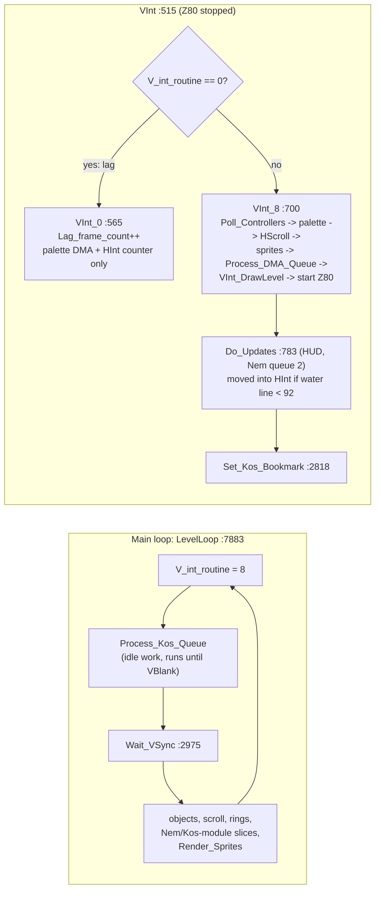
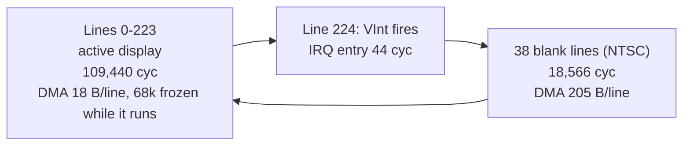

# Frame architecture: research

> [!verdict] Conclusion
> **The best known frame design on this hardware is not one game. It is four ideas that no single shipped engine combines.**
> 1. **Precomputed, budgeted commit.** The main loop builds VDP-ready DMA commands; VBlank only replays them, against a byte budget. Best shipped: Vectorman (double-buffered list, 54-entry and 2,880-byte dual cap). Fastest drain: Flamewing's Ultra DMA Queue in S.C.E.
> 2. **Preemptible idle work.** Long jobs (decompression) run after the frame's logic and before VBlank. When VBlank lands, the job is bookmarked and resumed next frame. Best shipped: S3K's `Set_Kos_Bookmark`. SGDK generalises it into a cooperative user task.
> 3. **A defined lag frame.** When logic overruns, VBlank commits only what is safe to commit. S3K commits palette and HInt only. One homebrew (The Chaos Layer) deliberately still commits scroll. Nobody commits an atomic snapshot of the previous complete frame.
> 4. **Buying more blanking.** Turning the display off from HInt turns any line into a VBlank line, worth +205 B of DMA per line. Thunder Force IV and Batman & Robin blank the display around their VDP update. Demos use it. No shipped engine sizes its letterbox to the frame's DMA debt.
>
> **The ceiling (NTSC, H40, V28):** 128,006 68000 cycles per frame. 38 non-picture lines ≈ 18,566 cycles. DMA: about **7.5 KB per VBlank** (published 7,524 B), plus 18 B per active line (4,032 B a frame) at the cost of freezing the 68000. PAL V28 has 89 non-picture lines and about **17.6 KB**.
>
> **What binds a Sonic-class frame:** first the VBlank DMA window, then 68000 cycles in the main loop. The VBlank's fixed commit (palette, sprites, HScroll, VSRAM) already takes about 23% of the NTSC window before any art or plane data moves.

This file covers sections 3 and 4 of the [[AUDIT_TEMPLATE|audit template]] only. It judges techniques, not aeon's code. Aeon appears only where a comparison needs a fixed point, and those points are marked *for reviewers*.

Labels: **MEASURED** (I ran it, or an aeon doc measured it), **PUBLISHED** (cited source), **ESTIMATED** (derivation shown). A disassembly fact I read myself at `path:line` is **PUBLISHED** from that source.

---

## 3. Best known approach

### 3.0 What a frame architecture has to decide

Every design below answers the same seven questions. The comparison table in §3.8 grades each design against them.

| # | Decision | Range of answers seen |
|---|---|---|
| D1 | Who runs game logic | main loop (everyone) vs inside VBlank (some modes of The Chaos Layer) |
| D2 | How VBlank picks its work | mode-index table (S3K, TF4) · function pointer (S.C.E., Ristar) · RAM-patched vector (The Chaos Layer) |
| D3 | What a lag frame commits | nothing · palette + HInt (S3K) · scroll but not sprites (The Chaos Layer) · whatever is queued |
| D4 | How the VDP commit is built | inline in VBlank (Treasure, TF4, Ristar) · queue drained in VBlank (S3K, S.C.E., SGDK) · precomputed double-buffered list (Vectorman) |
| D5 | How overload is bounded | none (Treasure, The Chaos Layer) · entry cap (S3K) · entry + byte cap (Vectorman, SGDK option) |
| D6 | Where long jobs run | blocking at load · per-frame slice (S3K Kos modules) · preemptible bookmark (S3K Kos queue) · cooperative task (SGDK) |
| D7 | How sound and the 68k share the bus | stop the Z80 for the whole VBlank (S3K, S.C.E.) · never stop it (The Chaos Layer) · driver drains a buffer during DMA (MegaPCM 2, MDSDRV) |

### 3.1 S3K and S.C.E.: the floor

**S3K frame shape** (PUBLISHED, `skdisasm/sonic3k.asm`):

- **Dispatch (D2).** `V_int_routine` is a byte index into `VInt_Table` (`:546`). The main loop arms it before waiting. VBlank clears it, so "zero at VBlank entry" means the main loop did not finish. That flag *is* the lag detector (`:518-519`, `:568`).
- **Lag frame (D3).** `VInt_0_Level` (`:583-645`) re-uploads the palette (normal or water) and re-arms the HInt counter, so the water line does not jump. It commits no sprites and no scroll, except in two-player mode. There, sprite tables are page-flipped because "incomplete sprite tables can be uploaded to the VDP on lag frames, causing corrupted sprites" (comment at `:622-624`). **S3K's own fix for torn commits was double buffering, used only where the bug was visible.**
- **Commit order (D4).** Controllers, then palette, then HScroll (`$380` B), then sprite table (`$280` B), then the DMA queue, then plane drawing by CPU (`VInt_DrawLevel`), all with the Z80 stopped (`:700-781`). The queue drain is a plain loop of 7 `move.w` per entry (`:1747-1767`), about 120 cycles per entry (ESTIMATED: 7 × 12 for `move.w (a1)+,(a5)` plus about 36 cycles of loop test).
- **Interrupt reentry.** Interrupts are re-enabled (`move #$2300,sr`, `:777`) *before* `Do_Updates`, so the HUD can be preempted by HInt. When the water HInt fires high on screen, the HUD work moves into HInt instead (`:779-781`).
- **Preemptible idle work (D6).** `Process_Kos_Queue` runs in the main loop *before* `Wait_VSync`, so it soaks up idle time. If VBlank lands while the PC is inside the decompressor, `Set_Kos_Bookmark` (`:2818-2831`) rewrites the stacked return PC to `Backup_Kos_Registers`. The RTE then banks the decoder's registers and returns to the main loop, and the next frame resumes. **This is the best shipped preemption on the console.** Its limits: one job type, one fixed PC range, and a decoder written to keep its state off the stack.
- **PAL.** VBlank wastes `$700` `dbf` iterations (about 19,700 cycles, ESTIMATED: 1,793 × 10 + 14) on PAL to "hide CRAM dots" (`:528-531`). A known cost, never recovered.

**S.C.E.** (PUBLISHED, `Sonic-Clean-Engine-S.C.E.-/Engine/Core/`) keeps the S3K order and cleans it up:
- A **function pointer** `V_int_ptr` replaces the index table (`Interrupt Handler.asm:38-43`). A shared `V_int_flag` drives lag detection (`:13-14`).
- The **Ultra DMA Queue** (Flamewing): VDP register bytes are pre-filled at init, and the drain jumps into an unrolled block at the right depth: 3 `move.l` + 1 `move.w` per entry, no loop test (`DMA Queue.asm:346-370`). That is **72 cycles per entry** (ESTIMATED: 3 × 20 + 12). Enqueue is 184 cycles, or 48 when the queue is full and the DMA is dropped (PUBLISHED, header comment `:38-40`).
- **Lagometer:** in DEBUG builds, `Wait_VSync` moves the window plane's H position on entry and exit, so the screen itself shows where the CPU idled (`Wait VSync.asm:11-22`).
- Still stops the Z80 for the entire level VBlank (`Interrupt Handler.asm:247-249`).

> [!note] Where S3K/S.C.E. break
> No byte budget: the queue is bounded only by slot count, so a heavy frame overruns into active display (top lines show garbage or late DMA). Lag frames show stale sprites against moving scroll, the half-commit S3K fixed only in two-player mode. The Z80 is stopped for the whole VBlank, which costs PCM samples. The PAL CRAM-dot delay wastes about 13% of a PAL frame (ESTIMATED: 19,700 / 152,923).

### 3.2 Best commercial approaches

**Vectorman (BlueSky, 1995): the best shipped commit pipeline.** (PUBLISHED, local `vectorman_disasm/ANALYSIS.md:84-200`)
- Objects enqueue `(length, source)` pairs during the main loop. The builder writes complete VDP register words into a RAM list, so VBlank math is zero.
- The list is **double-buffered**: VBlank drains last frame's list while the main loop fills the other. This is the only commercial example here where commit state is never torn by a lag frame, because the drained buffer is always a complete one.
- A **dual cap** is checked per entry: at most 54 entries and at most 2,880 bytes a frame (`cmpi.w #$36` / `#$B40`). A partial list succeeds; the rest waits.
- The drain spins on the DMA-busy bit and then disables DMA.
- Cost: 2,880 B is only about 38% of the NTSC window (ESTIMATED: 2,880 / 7,524). The cap is conservative because Vectorman also does CPU work in VBlank.

**Treasure: Gunstar Heroes (1993), Alien Soldier (1995).** (PUBLISHED, local `gunstar_disasm/ANALYSIS.md:98-150`)
- **Inline DMA** in VBlank, with no queue. That works because the per-frame load is steady (sprite art).
- Alien Soldier **pre-builds VDP command blocks** at fixed RAM addresses during the main loop, so VBlank only writes them out. Same idea as Vectorman, extended to register writes.
- HBlank is a RAM-patched vector at `$FFFFEE00`, so each scene installs its own raster handler.
- Where it breaks: there is no overload bound. It works only for a game whose DMA load is predictable. A streaming platformer's load is not.

**Thunder Force IV (Technosoft, 1992).** (PUBLISHED, local `thunderforce4_disasm/ANALYSIS.md:165-200`; `aeon/docs/research/megaact-bg-streaming/04-batman-tf4-ristar.md:80`)
- 10-mode VBlank dispatch, inline DMA, and a RAM-patched per-level HBlank.
- It **turns the display off for the duration of the VDP update** (`$1BB0` → `$1752` off, `$173E` on). An overrun then shows black lines instead of garbage. It also runs DMA at the blanking rate on any line the update spills into.

**Batman & Robin (Clockwork Tortoise, 1995).** (PUBLISHED, `04-batman-tf4-ristar.md:80`; local `disasm/ART_AND_COMPRESSION.md:19-40,120-127`)
- **Display off from VBlank entry until the main loop re-enables it** (`interrupts.asm:693` `$8134` to `main_loop.asm:5423` `$8164`). It is the same safety valve as TF4, with the window under main-loop control.
- Large unrolled CPU writes to the VDP. The local analysis claims some of them run during active display. That claim is the analysis author's and **not verified here**.

**Ristar (Sonic Team, 1995).** (PUBLISHED, local `ristar_disasm/ANALYSIS.md:158-200`)
- The HBlank vector points at a RAM `jmp abs.l`, which saves about 12 cycles on every HBlank over a pointer load plus `jsr`.
- VBlank uses a per-mode long pointer and checks a **decompressor-busy / yieldable flag** first, a cousin of S3K's bookmark.

**The Chaos Layer (homebrew, 2014): the lag-frame priority split.** (PUBLISHED, local `the_chaos_layer/notes/BOOT_AND_FRAME.md:294-330`)
- One VBlank handler uploads **VSRAM and HScroll *before* the main-loop-finished test** and palette + sprites after it. A lag frame still scrolls smoothly and only sprites and palette freeze.
- It is the only design in the set that chose what a lag frame commits *per resource* on purpose. Its weakness is the reverse case: moving scroll under frozen sprites tears the sprites against the world.
- It also ships a **player-visible CPU meter** in the window plane, and uses CPU copies (about 8,700 cycles a frame) where DMA would do the same work in about 4,100 (the notes' own measurement). It never stops the Z80 and has no VBlank budget.

### 3.3 SGDK: the best homebrew frame model

(PUBLISHED: [SGDK `src/sys.c`](https://raw.githubusercontent.com/Stephane-D/SGDK/master/src/sys.c), [`inc/dma.h`](https://raw.githubusercontent.com/Stephane-D/SGDK/master/inc/dma.h), [`inc/task.h`](https://raw.githubusercontent.com/Stephane-D/SGDK/master/inc/task.h))

- **VBlank work runs on the main thread, not in the interrupt.** `SYS_doVBlankProcess()` waits for VBlank start, then flushes the DMA queue (with Z80 bus protection), the scroll tables, and a palette fade step, then calls the user callback and reads the joypads. The interrupt itself stays short, so a long frame cannot pile interrupt work on top of logic. The cost: if logic overruns, the commit happens late, inside active display, and SGDK's log warns when the flush ends past line 3.
- **DMA queue with a per-frame byte cap.** The defaults are "7.2 KB on NTSC and 15 KB on PAL". By default all transfers run "whatever is the limit". An opt-in mode ignores transfers past the cap.
- **CPU load** is averaged over 8 frames, and a missed VBlank pins the load at 255 + misses. `SHOW_FRAME_LOAD` draws it as a sprite. That is a measured lagometer, like S.C.E.'s, but available in release.
- **Cooperative user task.** `TSK_userYield()` runs a background task "until the next vertical blanking interrupt, that will resume the supervisor task". `TSK_superPend(n)` blocks the main code for up to n frames while the task runs. This is S3K's Kos bookmark generalised to *any* code: the task has its own stack and the scheduler swaps contexts at VBlank.
- Where it breaks: one user task only, with no priorities. Commit in the main thread means a lag frame commits *late* rather than *not at all*, so a heavy frame can tear mid-screen.

### 3.4 Demoscene and homebrew practice

- **Extended blanking via HInt (letterbox).** Turn the display off from an HInt near the bottom of the screen (for example line 192–200) and back on in the top border. Every blanked line carries DMA at the VBlank rate. (PUBLISHED: Charles MacDonald and gasega68k on SpritesMind, summarised with sources in `aeon/docs/research/megaact-bg-streaming/05-online-and-tech-demos.md:49-54`; [SpritesMind "Megadrive video timings"](https://gendev.spritesmind.net/forum/viewtopic.php?p=8442).) Costs:
  - Each blanked line shows border colour and adds about 204–205 B.
  - The display-bit write takes effect at 16-pixel granularity.
  - Disabling the display mid-line "will always break something". Only in-border disable is useful, "at the cost of losing sprites during phase 1 and sprite tiles during phase 3" (Kabuto, via `05-online-and-tech-demos.md:43`).
- **Display-off DMA inside HBlank.** Blank the display for part of one HBlank to push a short burst, such as CRAM. Titan's Overdrive used it for a 512-colour image: "the limit is 23 before you run into the visible area" (Sik, cited at `05-online-and-tech-demos.md:114`). It costs the whole 68000 on those lines, so it is set-piece only.
- **Overdrive 2.** The renderer packs all changed patterns into one contiguous RAM area so each frame is one big DMA instead of many small ones, because setup overhead dominates small transfers. Kabuto reports the demo was often bound by "the DMA capacity" (PUBLISHED: [jix, *Pushing Polygons on the Mega Drive*](https://jix.one/pushing-polygons-on-the-mega-drive/); [megabites](https://megabitesblog.wordpress.com/2019/01/16/overdrive-2-a-voyage-to-the-boundaries-of-16-bit-part-1/)).
- **VRAM-to-VRAM copy DMA** runs at about half rate and **does not freeze the 68000**. It is the one transfer type that overlaps CPU work (PUBLISHED: md.railgun.works, via `05-online-and-tech-demos.md:36`).
- **Sound across DMA.** MegaPCM 2 offers "zero-config DMA protection (… simply don't stop Z80 on DMA's)". It claims to survive up to 24 KB of DMA against "games usually DMA 6–8 Kb at most" (PUBLISHED: [MegaPCM README](https://github.com/vladikcomper/MegaPCM)). MDSDRV documents a similar mechanism (PUBLISHED: [MDSDRV](https://github.com/superctr/MDSDRV)). The idea is that the Z80 plays from a RAM buffer while the 68k bus is unsafe, instead of being halted.
- **Tanglewood, Xeno Crisis.** No frame-pacing technique beyond SGDK/S3K practice is documented (`05-online-and-tech-demos.md:112-116`). Nothing material found.

### 3.5 Modern engine frame design (outside the Genesis)

| Technique | How it works | Genesis analogue | Source |
|---|---|---|---|
| **Fixed timestep, decoupled presentation** | Logic advances in fixed ticks from an accumulator. Rendering shows the latest complete state. Under overload, run extra logic ticks per displayed frame (catch-up) up to a clamp, instead of slowing the game. | Every Genesis engine here slows down instead (one tick per VBlank, lag = slowdown). A catch-up tick needs logic that is cheap enough to run twice, or a "logic-only" tick that skips render work. | PUBLISHED: [Fiedler, *Fix Your Timestep!*](https://gafferongames.com/post/fix_your_timestep/) |
| **Atomic display commit** | All display state for a frame is submitted as one object and applied at vblank entirely or not at all. A test-only commit asks whether it fits before committing. | The VDP has no atomic latch. The analogue is a complete double-buffered commit set (Vectorman's list, S3K 2P sprite page flip) and a budget check *before* the drain starts. | PUBLISHED: [LWN, *Atomic mode setting design overview*](https://lwn.net/Articles/653071/) |
| **Extract phase / render one frame behind** | The game thread finishes frame N, a short extract copies render state, and the render thread draws N while the game computes N+1. | The main loop is the game thread. VBlank is the render thread. The "extract" is building the commit list. Pipelining adds a frame of latency. | PUBLISHED: [Unreal, *Threaded Rendering*](https://dev.epicgames.com/documentation/en-us/unreal-engine/threaded-rendering-in-unreal-engine) |
| **Job/fiber scheduling into idle time** | Work is split into jobs that can suspend and resume. Several frames are in flight. | S3K Kos bookmark = one fiber. SGDK user task = one fiber. A small priority list of resumable jobs is the next step. | PUBLISHED: [Gyrling, *Parallelizing the Naughty Dog Engine Using Fibers*, GDC 2015](https://www.gdcvault.com/play/1022186/Parallelizing-the-Naughty-Dog-Engine) |
| **Frame pacing under overload** | Present at a steady cadence (for example, a clean 30 Hz) rather than oscillating between 60 and 30. Scale quality from measured frame time. | Lag frames today come in clumps (decode bursts). The levers are deferring optional work (decode, sweeps) from the measured scanline, and shrinking the commit (fewer tiles a frame). | PUBLISHED: [Android Frame Pacing library](https://developer.android.com/games/sdk/frame-pacing) |
| **Deterministic simulation for rollback/replay** | Input-only replay. Logic is a pure function of inputs and tick count. | Requires that logic never reads frame (VBlank) counters, only the tick counter. | PUBLISHED: [GGPO](https://www.ggpo.net/) |

### 3.6 Lag frames compared

| Design | Logic overruns → this VBlank commits | Torn-state risk |
|---|---|---|
| S3K / S.C.E. | palette + HInt counter (+ sprites in 2P, page-flipped) | none for sprites/scroll (both held), HUD/timer hold |
| The Chaos Layer | VSRAM + HScroll, not palette/sprites | sprites drift against scroll for the lag frame |
| SGDK | everything, but late (main-thread commit) | mid-screen tear when the flush runs into active display |
| Vectorman | previous complete list (double-buffered) | none: the drained list is always whole |
| Modern (KMS atomic) | previous complete state, or the new one, never a mix | none by construction |

*For reviewers:* the 2026-11-13 engine review recorded that aeon's `VInt_Lag` still ships the sprite table if dirty and HScroll always (`docs/research/2026-11-13-engine-systems-review.md:36`). That is a fifth row nobody else has, and stages 3–4 should place it.

### 3.7 Input and sound placement

- **Input.** S3K and S.C.E. poll inside VBlank with the Z80 stopped (`sonic3k.asm:701-702`; `Interrupt Handler.asm:247-250`). SGDK polls at the end of the main-thread VBlank process. Any engine that commits in VBlank has the same floor: input latched at VBlank N, logic in frame N, commit at VBlank N+1, scan-out during frame N+1. Button to photon is **≈1.0–1.9 frames (16.7–31.6 ms NTSC)**, depending on the screen line (ESTIMATED from the frame period). Each extra pipeline stage (for example render-one-frame-behind) adds a whole frame. A design that polls *later* than VBlank gains nothing, because logic starts at VBlank anyway.
- **Sound.** In S3K, the Z80 driver is autonomous and the 68k only posts commands. The cost is the stop/start brackets: everything in VBlank runs with the Z80 halted. The best known alternative is MegaPCM 2's: never stop the Z80 for DMA, and let the driver play from its buffer while a flag says DMA is live.

### 3.8 Scorecard of known approaches

| | D3 lag commit | D4 commit build | D5 overload bound | D6 idle work | D7 sound/bus |
|---|---|---|---|---|---|
| S3K | safe subset | queue + inline | slots only | **bookmark (1 job)** | Z80 stopped all VBlank |
| S.C.E. | safe subset | **Ultra queue (72 cyc/entry)** | slots only | bookmark (KosPlus) | Z80 stopped all VBlank |
| Vectorman | **whole previous list** | **precomputed, double-buffered** | **entries + bytes** | — | not documented |
| Treasure | not documented | inline / prebuilt blocks | none | — | not documented |
| TF4 / Batman | — | inline, **display-off overrun guard** | none (display-off hides it) | — | not documented |
| SGDK | late commit | queue (main thread) | bytes (opt-in drop) | **cooperative task** | bus protection around flush |
| MegaPCM 2 | — | — | — | — | **Z80 never stopped for DMA** |

Bold = best known in that column.

### 3.9 Techniques nobody has combined (beyond state of the art)

Each item is a combination that no source above ships. Plausibility is my estimate.

1. **Adaptive letterbox sized to DMA debt.** Each frame, compute the queued bytes left after the VBlank window. If the debt exceeds a threshold, arm a display-off HInt that blanks just enough bottom lines (about 205 B per line) to clear it. That is dynamic resolution, applied to DMA bandwidth. TF4 and Batman blank around the update unconditionally, and demos use fixed letterboxes. *Plausibility: high for a cinematic crossing, medium for normal play, because the border is visible.* It must coexist with the raster system's HInt ownership.
2. **Atomic commit with a double-buffered commit set.** Vectorman's double-buffered list plus the S3K 2P sprite page flip plus a KMS-style test-before-drain. A lag frame re-commits nothing (or re-commits the last complete set), and a normal frame commits only if the whole set fits the budget, or a declared prefix of it does. This removes torn sprite/scroll pairs by construction. *Plausibility: high; costs RAM for a second SAT/HScroll copy (640 + 896 B, ESTIMATED from the table sizes).*
3. **Fixed-timestep catch-up on a deterministic core.** Use the replay-grade determinism (a tick counter separate from the VBlank counter) to run two logic ticks in one displayed frame after a lag frame, with rendering only on the second. Game speed then stays constant under overload, which no Genesis game does. *Plausibility: medium. It needs a cheap logic-only tick, and a second tick must fit, so it suits rare spikes, not sustained overload.*
4. **A small preemptible job scheduler.** Generalise the single bookmark (S3K) and the single user task (SGDK) into a short priority list of resumable jobs: decode, residency sweep, block decompression, AI. Each job is bookmarked at VBlank by PC range or by its own stack, and resumed in priority order next frame. *Plausibility: high; the mechanism already exists for one job type in S3K and aeon.*
5. **Scanline-deadline scheduling.** Use the HV counter (as S.C.E.'s lagometer and SGDK's load meter already read it) to admit an optional job only if its worst-case cost fits before line 224 *and* the commit it produces fits the remaining DMA budget. That is one admission rule over both resources, which nobody ships. *Plausibility: high; needs per-job cost tables.*
6. **Sound-transparent extended blanking.** Combine items 1 and 2 with MegaPCM-style "DMA-live" flagging, so that the extra blanked-line DMA also never stops the Z80. Today's precedents do one or the other. *Plausibility: medium; the Z80 buffer must cover the longest DMA run (see §4.5).*
7. **Copy-DMA for compaction in active display.** VRAM-to-VRAM copy DMA does not freeze the 68000. Use it during active display for pool defragmentation or tile moves while logic runs, leaving the VBlank window for 68k→VRAM traffic. *Plausibility: medium. The VDP control port is off limits for the copy's duration, which collides with any HInt that writes the VDP.*

---

## 4. Hardware ceiling

### 4.1 Clocks and the frame (first principles)

| Quantity | NTSC | PAL | Label / derivation |
|---|---|---|---|
| Master clock | 53,693,175 Hz | 53,203,424 Hz | PUBLISHED ([Sega Retro, technical specifications](https://segaretro.org/Sega_Mega_Drive/Technical_specifications)) |
| 68000 clock | 7,670,454 Hz | 7,600,489 Hz | master ÷ 7 |
| Z80 clock | 3,579,545 Hz | 3,546,895 Hz | master ÷ 15 |
| Master clocks per line (H40) | 3,420 | 3,420 | PUBLISHED (railgun/Kabuto) |
| **68000 cycles per line** | **488.57** | **488.57** | ESTIMATED: 3,420 / 7. Kabuto measures about 480 usable (`05-online-and-tech-demos.md:21`) |
| Lines per frame | 262 | 313 | PUBLISHED |
| Frame rate | 59.92 Hz | 49.70 Hz | ESTIMATED: master / (lines × 3,420) |
| **68000 cycles per frame** | **128,006** | **152,923** | ESTIMATED: lines × 3,420 / 7 |
| Z80 cycles per frame | 59,736 | 71,364 | ESTIMATED: Z80 clock / frame rate |
| Active lines (V28) | 224 | 224 | aeon runs V28 on PAL too (reg 1 = `$34`/`$74`, `05-online-and-tech-demos.md:20`) |
| Active display cycles | 109,440 (85.5%) | 109,440 (71.6%) | ESTIMATED: 224 × 488.57 |
| **Non-picture (blanking) lines, V28** | **38** (Kabuto) / 36 (Sega table) | **89** (Kabuto) / 87 (Sega) | PUBLISHED; the sources disagree by 2 lines |
| Blanking cycles | 18,566 / 17,589 | 43,483 / 42,506 | ESTIMATED: lines × 488.57 |
| PAL V30 blanking | — | 73 lines (313 − 240), Sega 71 | PUBLISHED / ESTIMATED |

### 4.2 DMA bandwidth (H40)

| Quantity | Value | Label |
|---|---|---|
| 68k→VRAM, blanking or display off | **205 B/line** (Sega table); 204 by logic analyser (an extra refresh slot) | PUBLISHED (Sega Technical Overview; Mask of Destiny, SpritesMind t=1968, via `05-online-and-tech-demos.md:27-28`) |
| 68k→VRAM, active display | **18 B/line** (H32: 16) | PUBLISHED (same table; Kabuto slot map) |
| CRAM / VSRAM | one word per slot, so about twice the VRAM byte rate | PUBLISHED (railgun; Sik) |
| VRAM copy | about half the 68k→VRAM rate; 68k **not** frozen | PUBLISHED (railgun) |
| **Per VBlank, NTSC 320×224** | **7,524 B** (+ 4,032 active = 11,556 a frame) | PUBLISHED ([railgun table, reproduced by Sanglard](https://fabiensanglard.net/another_world_polygons_Genesis/index.html)) |
| Per VBlank, PAL 320×224 | **17,622 B** (+ 4,032 = 21,654) | PUBLISHED (same) |
| Per VBlank, PAL 320×240 | 14,454 B | PUBLISHED (same) |
| Per VBlank, NTSC, line-rate bound | 7,790 B | ESTIMATED: 38 × 205; the published 7,524 is 96.6% of it |
| Whole frame with display off | ≈ 53,700 B | ESTIMATED: 262 × 205, so all 64 KB of VRAM refills in about 1.2 frames |
| 68k cycles frozen per DMA byte | ≈ 2.38 | ESTIMATED: 488.57 / 205. Mask of Destiny: "every ~2.3 68K cycles, you lose one byte" |
| CPU-copy alternative | 5 cyc/byte (`move.l (a0)+,(a6)` = 20 cyc per 4 B) | ESTIMATED from 68000 timings, so about 2.1× DMA |
| Source restriction | a DMA cannot cross a 128 KB source boundary; length 0 = 65,536 | PUBLISHED ([plutiedev, DMA](https://plutiedev.com/dma-transfer); [hardware issues](https://plutiedev.com/hardware-issues)) |
| Engine caps chosen by others | SGDK 7,200 NTSC / 15,000 PAL; Vectorman 2,880 | PUBLISHED |

**Each extra blanked line (letterbox) is worth +205 B ≈ 6.4 tiles** (ESTIMATED: 205 / 32). Sixteen lines ≈ +3.3 KB, a 44% increase on the NTSC window.

### 4.3 The fixed commit floor

Every frame of a Sonic-class game must commit these before any art moves (ESTIMATED from table sizes):

| Item | Bytes |
|---|---|
| Palette (64 colours) | 128 |
| Sprite table (80 × 8) | 640 |
| HScroll, per-line, 224 lines × 4 | 896 |
| VSRAM, 20 column pairs × 4 | 80 |
| **Total** | **1,744 B ≈ 23% of 7,524** |

That leaves about 5,780 B ≈ 180 tiles for character DPLCs, plane rows and columns, and streamed art. One 48-tile character frame is 1,536 B. A 64-cell plane row is 128 B (ESTIMATED: 64 × 2).

### 4.4 Interrupt and dispatch costs (68000 timings)

| Item | Cycles | Label |
|---|---|---|
| IRQ acknowledge, autovector | 44 | PUBLISHED (M68000 User's Manual, exception timing table) |
| `rte` | 20 | PUBLISHED (same) |
| `movem.l d0-a6,-(sp)` / `(sp)+,d0-a6` | 128 / 132 | ESTIMATED: 8 + 8n / 12 + 8n, n = 15 |
| **Minimal full-save VInt envelope** | **≈ 324** | ESTIMATED: 44 + 128 + 132 + 20 |
| Minimal HInt via RAM `jmp abs.l` slot | ≈ 76 (+ register saves) | ESTIMATED: 44 + 12 + 20 |
| HInt on every active line, minimal | ≈ 17,000 = 13% of the frame | ESTIMATED: 224 × 76 |
| HInt on every line, 150-cycle handler | ≈ 33,600 = 26% | ESTIMATED: 224 × 150 |
| Interrupt latency jitter | up to the longest instruction in flight (`divs` ≈ 158, long `movem` ≈ 132) | ESTIMATED from 68000 timings; this sets raster-split precision |
| DMA queue drain per entry | S3K ≈ 120; Ultra queue 72 | ESTIMATED (§3.1) |

**Implication:** sparse HInt (a handful of splits) is nearly free. Dense HInt (every line) costs a tenth to a quarter of the 68000 before any game logic runs. A frame architecture must budget HInt as a first-class consumer, not as an effect.

### 4.5 Z80 bus contention

- While a 68k→VDP DMA runs, the 68k bus belongs to the VDP. A Z80 access to the 68k bus (the banked ROM window) **stalls until the DMA ends**. Ordinary Z80 bank reads also steal 68k cycles; one forum estimate puts heavy Z80 ROM streaming at about 5% of the 68k (PUBLISHED, forum-grade: [SpritesMind, wait states on Z80 bank access](https://gendev.spritesmind.net/forum/viewtopic.php?p=22062)).
- **Longest stall a PCM driver must ride out** (ESTIMATED):

  | Case | 68k cycles | Time | Samples at 16 kHz | at 32 kHz |
  |---|---|---|---|---|
  | Full NTSC VBlank DMA, 7,524 B × 2.38 | 17,900 | 2.33 ms | 37 | 75 |
  | Full PAL VBlank DMA, 17,622 B × 2.38 | 41,900 | 5.51 ms | 88 | 176 |
  | NTSC + 16-line letterbox (+3,280 B) | 25,700 | 3.35 ms | 54 | 107 |

  So any DMA-transparent sound design needs a RAM buffer of at least about 40 samples at 16 kHz for NTSC (ESTIMATED), and more than twice that for PAL or a letterbox. MegaPCM 2's claimed 24 KB tolerance covers all three cases (PUBLISHED claim, unverified).
- Stopping the Z80 (bus request) instead stalls *all* Z80 work for the hold, so the cost is the hold length in samples, the same arithmetic as the table.

### 4.6 What binds frame architecture, and where aeon sits

**Binding order for a Sonic-class streaming game:**
1. **VBlank DMA bytes.** These are fixed by hardware. The fixed commit takes 23%. Only blanking more lines (letterbox, PAL) raises the limit.
2. **68000 cycles in the main loop**, about 109K in active display and less in practice once HInt and VBlank work are taken out. Overrun produces a lag frame.
3. **VBlank CPU time.** Any non-DMA work in VBlank (plane CPU writes, controller reads, register shadows) spends window time at about 5 cycles per byte instead of 2.38.
4. RAM, for double buffers. ROM and VRAM do not bind the frame architecture itself.

**Aeon against the ceiling** (*for reviewers*; the code is judged in stages 3–4):

| Item | Aeon value | Ceiling | % of ceiling | Label |
|---|---|---|---|---|
| NTSC VBlank DMA budget | 6,144 B (`engine/system/constants.emp:771`) | 7,524 B published / 7,790 line-bound | **81.7%** / 78.9% | MEASURED (constant) vs PUBLISHED |
| PAL VBlank DMA budget | 11,648 B (`engine/system/constants.emp:772`, derived from "72 blank lines") | 17,622 B (V28; aeon runs V28) | **66.1%** | MEASURED (constant) vs PUBLISHED. The V28/V30 mismatch was already found in `05-online-and-tech-demos.md:20,133`; still present at `engine/system/constants.emp:760` |
| Cycles per DMA byte assumed | 2.7 (`engine/system/constants.emp:761`) | 2.35–2.38 | 12–13% pessimistic | MEASURED (constant) vs PUBLISHED/ESTIMATED |
| Tile streaming, diagonal OJZ | ~48K cycles per tick | 128,006 per frame | ~37.5% of a frame | MEASURED (`docs/research/2026-09-27-ojz-feel.md`, cited at `2026-11-13-engine-systems-review.md:29`) |
| Lag frames, run legs (EHZ) | 1 (release) to 6 (DEBUG) | — | — | MEASURED (`docs/research/2026-09-27-ehz-run-lag.md:311`) |
| Letterbox / display-off DMA extension | absent (no display-off write found in `engine/effects/raster.emp` or `engine/system/hblank.emp`) | +205 B/line | 0% used | MEASURED by grep, this stage |
| Lag-frame commit policy | ships sprites (if dirty) + HScroll | S3K: neither | — | cited, `2026-11-13-engine-systems-review.md:36` |
| Idle-time preemption | ZX0R bookmark by PC range (`engine/system/vblank.emp:68-79`); slices in `VSync_Wait` (`:499-552`) | S3K parity of mechanism; SGDK task is more general | — | read, this stage |
| Z80 during VBlank DMA | not stopped (DMA-active flag bracket, `vblank.emp:130` raise / `:293` lower) | MegaPCM 2 model | at best known | read, this stage |

**NEEDS-RUNTIME for stage 2:** VBlank cycles used per handler (VInt_Level, VInt_Lag) on the fixed legs; DMA bytes actually committed per frame against the 6,144 budget; the line at which VBlank work ends (overrun into active display); the PAL window measured, not derived.

---

## Sources

- skdisasm `sonic3k.asm` (lines cited inline); S.C.E. `Engine/Core/Interrupt Handler.asm`, `DMA Queue.asm`, `Wait VSync.asm`, `Draw Level.asm`.
- Local commercial analyses under `/home/volence/sonic_hacks/The Adventures of Batman and Robin/`: `vectorman_disasm/ANALYSIS.md`, `gunstar_disasm/ANALYSIS.md`, `thunderforce4_disasm/ANALYSIS.md`, `ristar_disasm/ANALYSIS.md`, `disasm/ART_AND_COMPRESSION.md`, `the_chaos_layer/notes/BOOT_AND_FRAME.md`.
- Prior aeon research reused here: `docs/research/megaact-bg-streaming/04-batman-tf4-ristar.md`, `05-online-and-tech-demos.md`, `docs/research/2026-11-13-engine-systems-review.md`.
- [SGDK sys.c](https://raw.githubusercontent.com/Stephane-D/SGDK/master/src/sys.c) · [SGDK dma.h](https://raw.githubusercontent.com/Stephane-D/SGDK/master/inc/dma.h) · [SGDK task.h](https://raw.githubusercontent.com/Stephane-D/SGDK/master/inc/task.h)
- [Fabien Sanglard, Another World on Genesis (DMA bytes-per-frame table)](https://fabiensanglard.net/another_world_polygons_Genesis/index.html)
- [plutiedev, DMA transfer](https://plutiedev.com/dma-transfer) · [Sega Retro, technical specifications](https://segaretro.org/Sega_Mega_Drive/Technical_specifications)
- [SpritesMind, Megadrive video timings](https://gendev.spritesmind.net/forum/viewtopic.php?p=8442) · [SpritesMind, wait states on Z80 bank access](https://gendev.spritesmind.net/forum/viewtopic.php?p=22062)
- [MegaPCM 2](https://github.com/vladikcomper/MegaPCM) · [MDSDRV](https://github.com/superctr/MDSDRV)
- [jix, Pushing Polygons on the Mega Drive](https://jix.one/pushing-polygons-on-the-mega-drive/) · [megabites, Overdrive 2](https://megabitesblog.wordpress.com/2019/01/16/overdrive-2-a-voyage-to-the-boundaries-of-16-bit-part-1/)
- [Fiedler, Fix Your Timestep!](https://gafferongames.com/post/fix_your_timestep/) · [LWN, Atomic mode setting](https://lwn.net/Articles/653071/) · [Unreal, Threaded Rendering](https://dev.epicgames.com/documentation/en-us/unreal-engine/threaded-rendering-in-unreal-engine) · [Gyrling, GDC 2015](https://www.gdcvault.com/play/1022186/Parallelizing-the-Naughty-Dog-Engine) · [Android Frame Pacing](https://developer.android.com/games/sdk/frame-pacing) · [GGPO](https://www.ggpo.net/)

> [!note] Limits of this stage
> - md.railgun.works and segaretro's DMA page refused automated fetches (bot protection) during this run. Their figures are cited through Sanglard's reproduction and the earlier aeon research that read them.
> - No emulator ran. Every aeon cost above is either a constant or cited from an earlier aeon measurement.
> - The Batman & Robin active-display-write claim and the Mickey Mania letterbox claim remain unverified.
