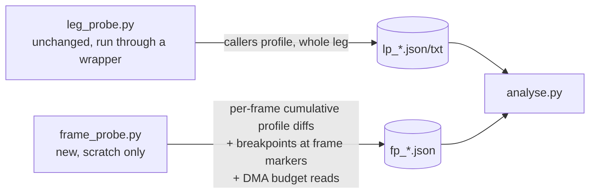
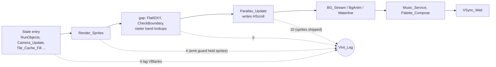

# Frame architecture: measurements (section 5)

> [!verdict] The short version
> - **Lag is rare and only appears when the camera moves on two axes at once.** Over 9 legs (about 12,000 video frames) there were **18 lag frames**: 10 when flying diagonally in DEBUG, 6 in the DEBUG spindash run and 2 in the release spindash run. Idle, running, straight flight right and straight flight down had **0**.
> - **The main loop leaves a lot of time spare on average and very little on the worst frames.** Game logic averages 38k to 71k cycles a tick out of 128,006 (30% to 56%). The worst tick costs **196.8k cycles (1.54 frames)**, and in every case the spike is `Tile_Cache_Fill` (up to 109.6k in one call).
> - **The suspected lag-tail defect happens.** No lag VBlank landed in the short gap between `Render_Sprites` returning and `Parallax_Update` starting (0 of 18). But **10 of the 18 landed inside `Parallax_Update`**, with `Sprite_Table_Dirty = 1`. On those frames `VInt_Lag` queues the sprite table for the new camera, plus HScroll from a buffer that is partly written. The camera had moved 6 to 16 px in X and 9 to 16 px in Y since the last complete HScroll. Another 4 of the 18 landed inside `Render_Sprites`. There the `Sprite_Emit_Active` guard held the sprite table back, as designed.
> - **The worst VBlank uses almost all of vertical blank.** `VInt_Level` averages about 9k to 11k cycles. Its worst call was **18,052** cycles (DEBUG diagonal), about **97%** of the ~18,566-cycle vertical blank (that ceiling is ESTIMATED). The worst release call was 15,242 (82%).
> - **DMA is well under budget.** The most charged in any VBlank was **3,592 B of the 6,144 B `DMA_BUDGET_NTSC`** (58%). No frame went over budget.

All numbers are **MEASURED** unless labelled otherwise. 128,006 cycles is one NTSC video frame, measured as the mean cycles per frame window (127,983 to 128,033). It matches the ESTIMATED 262 lines × 3420 mclk ÷ 7 = 128,005.7. The harness constant `FRAME_CYC = 127840` (`leg_probe.py`) is 166 cycles short. That only affects its printed "frames/tick" figure.

## How it was measured

- **Emulator.** The `oracle` checkout has no `target/` build, and this stage is not allowed to build. Both probes therefore ran the archived headless core `/home/volence/sonic_hacks/.oracle-bin-archive/549dc4f/oracle-aether` (2026-09-26). The archive is the same era as the perf-survey harness. A wrapper (`bin/run_leg.py`) points the imported `lag_flythrough_probe.SERVER` at that binary and changes nothing else. One headless emulator ran at a time, in the foreground. No `mcp__oracle__*` tool was used.
- **ROMs** (frozen copies): `s4.bin` CRC `193507d9` (850,296 B) and `s4.debug.bin` CRC `ce326232` (870,560 B).
- **Lag rule** (the perf survey's): lag frames over a window = Σ dFrame_Counter − Σ dLogic_Tick. `Frame_Counter` advances on both VBlank paths (`engine/system/vblank.emp:323`, `:472`). `Logic_Tick` advances once per completed tick (`engine/system/game_loop.emp:30`). There is a second witness for each shape:
  - DEBUG: the `Lag_Frame_Count` delta (`vblank.emp:476`) matched the rule on every leg.
  - Release, which has no such counter: the profiler's `VInt_Lag` call count matched (release spin: 2 = 2).
- **Determinism.** `leg_probe.py` and `frame_probe.py` gave identical lag counts, camera paths and end points on all 7 legs both ran. The breakpoints in `frame_probe` stop the core mid-frame but change inputs only at whole-frame boundaries, so they do not perturb the run.
- **Per-frame attribution.** The profiler's per-frame ring reports `perFrameExact: false`, and its per-routine "last frame" values did not reconcile with the totals. I did not use them. Instead, `frame_probe` reads the **cumulative exact totals** after every frame and differences them. A routine's cost lands in the frame window where the call returns, so "worst" below means **worst single invocation**. Routine inclusive cycles exclude interrupt time and include DMA stall. Per window, sample = vint + hint + main-context work, to within ~150 cycles.
- **Completeness.** Every `leg_probe` profile reported identity remainder **0**, truncated = False, abandoned = 0 and depthExceeded = 0. The run log `measure/out/legs.meta` shows every leg with rc = 0 and two stamps: `finished=1` for the first run and `finished=8` for the second.

### The legs

| Leg | Shape | Drive | Frames requested → run | Why it stopped | Covers |
|---|---|---|---|---|---|
| idle | both | no input (DEBUG: B to leave free flight first) | 600 → 600 | cap | standing at (96,429) |
| fly right (top speed) | DEBUG | free flight, 16 px/tick | 2000 → 418 | camera stalled 60 frames at the act edge (5824,144) | whole act width |
| fly down | DEBUG | free flight | 2000 → 423 | stalled at (96,5920) | whole act height |
| diagonal fly right+down | DEBUG | free flight | 2000 → 433 | stalled at (5824,5920) | worst camera case |
| run right | both | hold right, jump every 45 frames | 3000 → 3000 | cap | ⚠ **gets stuck bouncing at camera x ≈ 1046** for most of the leg, in both shapes (the oscillation the perf survey also saw) |
| spindash right | both | spindash every 150 frames | 3000 → 1235 / 1230 | stalled at (5824,5821) | **whole act, including the shaft fall**. This is the release traversal and the release "diagonal fall" |
| top-speed fly | release | n/a | DID NOT RUN | release has no free flight | |
| object-heavy / sidekick | n/a | n/a | DID NOT RUN | the harness cannot drive one. No sidekick ships, and OJZ act 1 has 11 objects | see NEEDS-RUNTIME |

## a) Lag frames per leg

| Leg | DEBUG `ce326232` | release `193507d9` | 2026-09-25 survey (older ROMs), for reference |
|---|---|---|---|
| idle | **0** / 600 | **0** / 600 | (not run) |
| fly right | **0** / 358 | n/a | 6/364 (all `PageCache_Audit` pairs) |
| fly down | **0** / 363 | n/a | 6/369 |
| diagonal fly | **10** / 373 | n/a | 49/412 |
| run right (stuck bouncing) | **0** / 3000 | **0** / 3000 | DEBUG 66/1,179, release 55/1,838 (different path) |
| spindash (whole act) | **6** / 1175 | **2** / 1170 | release 21/1,183; DEBUG stuck at x 983 then |

The figures are lag / video frames while the camera moves. The survey column is MEASURED in `docs/research/2026-09-25-perf-survey.md` on different ROMs. It shows the trend, not a like-for-like comparison. `PageCache_Audit` now runs as about 1.5k-cycle slices, two per tick: one from `VSync_Wait` (`vblank.emp:534`) and one from the state. The old 236k one-shot pairs are gone.

## b) Per-frame budget split

Each entry is the average per tick, with the worst single invocation in brackets. "Logic" is the main-loop work after `VSync_Wait` returns: the game state plus `Input_Tick`, `Sound_DrainSfxRing`, `Music_Service` and `Palette_Compose`. "Idle work" is what `VSync_Wait` does before it spins (`PageIn_Process`, `PageCache_LiveSweep`, and `PageCache_Audit` in DEBUG). "Slack" is the `VSync_Wait` self cycles: the busy-wait left over each tick.

| Leg | Logic | VBlank (vint bucket) | of which `VInt_Level` | `VInt_Lag` (n) | HBlank (calls) | Idle work | Slack: avg (min) |
|---|---|---|---|---|---|---|---|
| DEBUG idle | 47.9k (67.1k) | 9.4k (11.2k) | 9.0k (10.8k) | none | 1,344 (3) | 3.1k (3.3k) | 66.1k (49.8k) |
| release idle | 37.8k (40.3k) | 9.2k (10.7k) | 8.8k (10.3k) | none | 1,344 (3) | 0.37k | 79.1k (76.8k) |
| DEBUG fly right | 51.4k (97.4k) | 9.9k (12.0k) | 9.4k (11.5k) | none | 361 (0 to 3) | 3.1k (3.3k) | 63.1k (17.3k) |
| DEBUG fly down | 47.9k (83.4k) | 9.6k (12.7k) | 9.2k (12.3k) | none | 1,273 (0 to 7) | 3.1k (3.3k) | 66.0k (31.4k) |
| DEBUG diagonal | 71.3k (**197.0k**) | 11.6k (**18.1k**) | 11.3k (17.6k) | 6.5k (8.4k) ×10 | 995 (0 to 8, max 4,960 cyc) | 3.0k (6.1k) | 40.0k (**60**) |
| DEBUG run | 52.7k (110.7k) | 9.7k (13.9k) | 9.2k (13.5k) | none | 1,344 (3) | 3.1k (3.3k) | 61.0k (2.1k) |
| DEBUG spindash | 59.2k (112.9k) | 10.4k (16.5k) | 9.9k (16.1k) | 6.9k (8.1k) ×6 | 865 (0 to 5) | 3.1k (6.1k) | 54.3k (70) |
| release run | 39.6k (98.6k) | 9.4k (13.3k) | 9.0k (12.9k) | none | 1,344 (3) | 0.37k | 77.2k (17.3k) |
| release spindash | 46.8k (106.1k) | 10.0k (15.2k) | 9.6k (14.8k) | 6.8k (7.5k) ×2 | 763 (0 to 5) | 0.37k | 69.9k (70) |

> [!finding] The worst tick is always the tile cache
> On every leg, the worst tick's spike is `Tile_Cache_Fill`. Its worst single call per leg:
>
> | Leg | Worst `Tile_Cache_Fill` call |
> |---|---|
> | DEBUG diagonal | **109,602** |
> | DEBUG spindash | 81,692 |
> | release spindash | 81,066 |
> | fly right | 65,524 |
> | run | 58.7k |
>
> The DEBUG diagonal's worst tick was 196,794 cycles in `GameState_OJZScroll_Update` alone, which is 1.54 frames. Average logic (30% to 56% of a frame) is far from the ceiling. Lag comes from single-tick spikes, not from the average.

> [!note] The VBlank window (ESTIMATED ceiling, MEASURED cost)
> With 224 lines, vertical blank is (262 − 224) × 3420 ÷ 7 ≈ **18,566** cycles. The worst VBlank interrupt costs:
>
> | Leg | Worst VBlank | Share of vertical blank |
> |---|---|---|
> | DEBUG diagonal | 18,052 | 97% |
> | DEBUG spindash | 16,494 | 89% |
> | release spindash | 15,242 | 82% |
>
> The average is about 9.2k to 11.6k (50% to 63%). On the worst frame, the biggest parts are:
> - `VInt_DrawLevel`: up to 7,004 (DEBUG diagonal), 3,506 (release)
> - `Process_DMA_Deferrable`: up to 4,954
> - `Process_DMA_Critical`: up to 3,354, about 2.2k to 2.5k of which is DMA stall
>
> Whether the last DMA really finishes before line 0 has not been measured. It is on the NEEDS-RUNTIME list.

### Per-routine cost in the frame-structure path

Each cell is the average per call, with the worst single call in brackets.

| Routine | Where it runs | DEBUG diagonal | DEBUG spindash | release run | release spindash |
|---|---|---|---|---|---|
| `VBlank_Handler` | IRQ6 (`vblank.emp:43`) | 11,584 (18,008) | 10,313 (16,450) | 9,363 (13,246) | 10,003 (15,198) |
| `Raster_VBlank` | VBlank | 463 (1,856) | 633 (1,856) | 1,148 (1,154) | 580 (1,856) |
| `Flush_VDP_Shadow` | VBlank | 698 (698) | 698 | 698 | 698 |
| `Enqueue_Dirty_Buffers` | VBlank (`vblank.emp:167`, `:362`) | 1,045 (2,010) | 1,165 (2,104) | 1,394 | 1,166 (2,104) |
| `VInt_DrawLevel` | VInt_Level only (`:176`) | 4,080 (7,004) | 1,565 (3,612) | 129 (1,378) | 1,460 (3,506) |
| `Process_DMA_Critical` | both paths (`:206`, `:456`) | 2,539 (3,217), stall 2,217 | 2,681 (3,354) | 2,652 (2,901) | 2,624 (2,912) |
| `Vscroll_Write` | both paths | 184 | 184 | 184 | 184 |
| `Process_DMA_Important` | VInt_Level only | 52 | 744 (2,694) | 472 (3,078) | 746 (2,694) |
| `Process_DMA_Deferrable` | VInt_Level only (`:282`) | 163 (4,505) | 162 (4,954) | 256 (3,040) | 145 (3,040) |
| `Read_Controllers` | both paths (`:298`, `:471`) | 1,048 | 1,048 | 1,048 | 1,048 |
| `HBlank_Vector_Slot` | HInt | 924/tick, 2.1 calls | 787/tick | 1,212/tick, 3 calls | 688/tick |
| `VSync_Wait` idle: `PageIn_Process` | main, idle slot | 332 | 332 | 332 | 332 |
| `VSync_Wait` idle: `PageCache_LiveSweep` | main, idle slot | 38 | 38 | 38 | 38 |
| `VSync_Wait` idle: `PageCache_Audit` (DEBUG) | idle slot + state | 2 calls/tick, 1,502/call (slice max 19,818 per window) | same | n/a | n/a |
| Page decode slices (`ZX0R_Decompress`, `PageIn_BankRegs`) | idle slot | **0 calls** | 0 | 0 | 0 |
| `Music_Service` | main, after state (`game_loop.emp:44`) | 50 | 50 | 50 | 50 |
| `Sound_DrainSfxRing` | main, before state | 54 (252) | 56 (252) | 59 (252) | 56 (252) |
| `Input_Tick` | main | 38 | 38 | 38 | 38 |
| `Palette_Compose` | main, last (`game_loop.emp:55`) | 299 (10,210) | 221 (10,210) | 180 | 213 (10,210) |
| `Render_Sprites` | state (`ojz_scroll_test.emp:1263`) | 3,378 (8,042) | 6,375 (12,424) | 2,816 (7,438) | 2,715 (7,570) |
| `Parallax_Update` | state (`ojz_scroll_test.emp:1462`) | 8,191 (19,132) | 7,879 (12,750) | 7,426 | 7,642 (12,186) |

Notes:
- The other legs show the same small-routine figures; `measure/out/analysis.txt` has the full per-leg tables.
- `Palette_Compose` peaked at 27,292 on the DEBUG fly-right leg, in one tick.
- Page decode never ran on any leg, because OJZ act 1 is fully resident. The idle-slot decoder needs a streaming act to measure. It is on the NEEDS-RUNTIME list.

## c) Top routines by cycles, with callers

These come from the `leg_probe.py --profile` whole-leg profiles. The numbers are cycles per logic tick, inclusive.

> [!note] One naming quirk in the profiles
> The top row (`$engine.tile_cache$Tile_Cache_Fill$h_left_pos` in DEBUG, `GameState_OJZScroll_Update` with 0 calls in release) is the profiler's pseudo-root. It is whatever routine was running when the profiler was armed, and it stands in for `GameLoop`. It is not a real cost of that routine.

**DEBUG diagonal fly (the worst leg).** Work is 85.7k/tick, or 0.670 frames. vint is 11,876/tick and hint 1,017/tick.

| Routine | incl/tick | self/tick | calls/tick | Main callers |
|---|---|---|---|---|
| `GameState_OJZScroll_Update` | 72,205 | 800 | 1.00 | GameLoop |
| `VSync_Wait` | 45,033 | 41,984 | 1.00 | GameLoop (idle + slack) |
| `Tile_Cache_Fill` | 38,045 | 2,384 | 1.00 | state |
| `TileCache_FillRow` | 18,283 | 11,231 | 1.73 | Tile_Cache_Fill |
| `TileCache_FillColumn` | 16,755 | 3,264 | 1.69 | Tile_Cache_Fill |
| `Section_UpdateColumns` | 13,037 | 1,444 | 1.00 | state |
| `VBlank_Handler` → `VInt_Level` | 11,831 → 11,290 | 388 / 1,045 | 1.02 / 1.00 | IRQ6 |
| `TileCache_CopyBlockColumn` | 10,788 | 6,375 | 7.75 | FillColumn |
| `Parallax_Update` | 8,172 | 7,022 | 1.00 | state |
| `PageCache_PatchRun_Col` / `_Seq` | 4,413 / 3,706 | same | 9.4 / 10.0 | CopyBlockColumn / FillRow |
| `VInt_DrawLevel` | 4,070 | 4,070 | 1.00 | VInt_Level |
| `Canopy_Probe` (DEBUG) | 4,021 | 4,021 | 1.00 | Section_UpdateColumns |
| `Render_Sprites` | 3,370 | 2,632 | 1.00 | state |
| `TileCache_DecompressBlock` → `S4LZ_DecompressDict` | 3,016 → 1,976 | | 1.21 / 0.18 | FillRow, FillColumn, Tile_Cache_Fill |
| `PageCache_Audit` (DEBUG) | 2,997 | 542 | 2.00 | VSync_Wait 2,680, state 317 |
| `Process_DMA_Critical` | 2,594 | 2,594 | 1.02 | VInt_Level 2,535, VInt_Lag 59 |
| `Read_Controllers` / `Enqueue_Dirty_Buffers` / `Flush_VDP_Shadow` | 1,070 / 1,068 / 713 | | 1.02 | VInt_Level + VInt_Lag |
| `HBlank_Vector_Slot` | 924 | 924 | 2.10 | HInt |

**Release spindash (the whole act, including the shaft fall).** Work is 57.7k/tick, or 0.452 frames. vint is 10,055/tick and hint 764/tick.

| Routine | incl/tick | calls/tick | Main callers |
|---|---|---|---|
| `VSync_Wait` | 70,381 (self 70,012) | 1.00 | GameLoop |
| `GameState_OJZScroll_Update` | 46,397 | 1.00 | GameLoop |
| `Tile_Cache_Fill` | 15,087 | 1.00 | state |
| `RunObjects` → `Player_Main` | 10,968 → 8,831 | 1.00 | state |
| `VBlank_Handler` → `VInt_Level` | 10,011 → 9,620 | 1.00 | IRQ6 |
| `Parallax_Update` | 7,636 | 1.00 | state |
| `TileCache_FillRow` / `FillColumn` | 6,460 / 5,584 | 0.68 / 0.64 | Tile_Cache_Fill |
| `Section_UpdateColumns` | 3,482 | 1.00 | state |
| `Render_Sprites` | 2,713 | 1.00 | state |
| `Process_DMA_Critical` | 2,627 | 1.00 | VInt_Level 2,622, VInt_Lag 4 |
| `VInt_DrawLevel` | 1,459 | 1.00 | VInt_Level |
| `Read_Controllers` / `Enqueue_Dirty_Buffers` | 1,049 / 1,167 | 1.00 | VInt_Level + VInt_Lag |
| `Music_Service` | 50 | 1.00 | GameLoop |

The full top-40 tables, with callers, for all 7 profiled legs are in `measure/out/lp_<leg>.txt`.

## d) Where lag VBlanks land (the lag-tail test)

`frame_probe` sets execution breakpoints at the state entry, `Render_Sprites`, `Parallax_Update`, `BG_Stream_Update`, `Music_Service`, `Palette_Compose`, `VSync_Wait`, `VInt_Level` and `VInt_Lag`. That gives the order of events in every tick. At each `VInt_Lag` it also reads:
- the interrupted PC (from the exception frame under the `movem`),
- `Sprite_Table_Dirty` and `Sprite_Emit_Active`, which are what `Enqueue_Dirty_Buffers` checks before queueing the sprite table (`engine/system/buffers.emp:464-473`),
- the camera.

HScroll is queued on every VBlank on both paths, from `SRC_HSCROLL` (`buffers.emp:507`).

| Where the lag VBlank landed | DEBUG diagonal | DEBUG spindash | release spindash | Total | Sprite table shipped? | Camera moved since last complete HScroll |
|---|---|---|---|---|---|---|
| In the state, before `Render_Sprites` (inside `TileCache_*`, `S4LZ`, `EntityWindow`) | 4 | 0 | 0 | 4 | no (dirty = 0) | n/a: nothing new ships |
| Inside `Render_Sprites` / `DrawRings` | 2 | 2 | 0 | 4 | **no**: `Sprite_Emit_Active = $FF` held it back (`buffers.emp:466`) | 16,16 / 6,9 / 6,15 px |
| Gap between `Render_Sprites` returning and `Parallax_Update` entry | 0 | 0 | 0 | **0** | | |
| **Inside `Parallax_Update`** (`Parallax_Fill_PerLine`, `Parallax_Step4_Fill`, `Parallax_Step5_Vscroll`) | 4 | 4 | 2 | **10** | **yes** (dirty = 1, emit = 0) | DEBUG diagonal 16,16; spindash 6,9 to 6,15 px |
| After `Parallax_Update` | 0 | 0 | 0 | 0 | | |

> [!finding] The suspected defect shows up on 10 of 18 lag frames (MEASURED)
> On 10 of the 18 lag frames, `VInt_Lag` queued the freshly rendered sprite table, which was drawn at the new camera. On the same frames, `Parallax_Update` had not finished writing HScroll, and the camera had moved 6 to 16 px since the last complete HScroll. Each case is listed with its interrupted PC in `measure/out/analysis.txt`. The suspected window really runs from `Render_Sprites`' return to the end of `Parallax_Update`, not just to its entry. Only the second half of that window was ever hit, because `Parallax_Update` is where the time goes.
>
> Measured: whether HScroll is single-buffered or double-buffered is not settled here. Neither is what reaches the screen. If `SRC_HSCROLL` is the buffer `Parallax_Update` writes into, those 10 frames ship a torn HScroll (part new, part old). Reviewers should confirm this in code. How it looks is on the NEEDS-RUNTIME list.

## e) DMA bytes committed per VBlank vs `DMA_BUDGET_NTSC` (6,144 B, `engine/system/constants.emp:771`)

Each `VInt_Level` was instrumented in three places:
- At `.charged_critical`: plane-drain bytes = budget − `DMA_Budget_Remaining`. Critical bytes = 2 × `d1`, the queue's word sum.
- Important + Deferrable drained = the post-floor remainder − the remainder read at the next `VInt_Level` entry.
- The enqueue-side total `DMA_Enq_Bytes_Frame` is read at that same next entry.

| Leg | Plane: avg (max) | Critical: avg (max) | Important + Deferrable: avg (max) | **Total: avg (max)** | Over budget |
|---|---|---|---|---|---|
| DEBUG idle | 0 | 1,083 (1,088) | 71 (544) | 1,154 (1,632) | 0 / 599 |
| release idle | 0 | 1,083 (1,088) | 70 (544) | 1,153 (1,632) | 0 / 599 |
| DEBUG fly right | 226 (272) | 947 (1,032) | 16 (128) | 1,189 (1,432) | 0 / 417 |
| DEBUG fly down | 221 (264) | 949 (1,048) | 16 (128) | 1,186 (1,440) | 0 / 422 |
| DEBUG diagonal | 447 (800) | 951 (1,192) | 36 (1,792) | 1,434 (3,360) | 0 / 422 |
| DEBUG run | 5 (136) | 1,007 (1,168) | 209 (1,632) | 1,220 (2,688) | 0 / 2999 |
| DEBUG spindash | 159 (400) | 1,002 (1,184) | 264 (2,368) | 1,425 (**3,592**) | 0 / 1228 |
| release run | 5 (136) | 983 (1,088) | 209 (1,568) | 1,196 (2,560) | 0 / 2999 |
| release spindash | 158 (400) | 978 (1,088) | 259 (1,568) | 1,394 (2,696) | 0 / 1227 |

Notes:
- The peak is **58% of the budget**. The ESTIMATED hardware ceiling is about 205 B per blank line in H40 (PUBLISHED: the Sega Genesis VDP DMA bandwidth figure, as tabled on plutiedev) × 38 lines ≈ 7,790 B.
- The measured `Process_DMA_Critical` stall (about 2.2k to 2.5k cycles) is about 5 blank lines. At the published rate that is about 1.0 to 1.1 KB, which agrees with the ~1,083 B Critical charge.
- **Lag frames are not charged.** `VInt_Lag` ships Critical (and therefore the sprite table and HScroll) without touching `DMA_Budget_Remaining`, so those frames are not in this table. Its stall averaged 2.2k to 2.3k cycles per call, about the same as a normal Critical drain.
- `DMA_Bytes_ThisFrame` is cleared in DEBUG `VSync_Wait` (`vblank.emp:550`). No other source line in `engine/` or `games/` refers to it, so it cannot report anything. This is a code-quality pointer for the reviewers.

## How cost grows with objects, rings or layers

Not measurable with the shipped content.
- `RunObjects` costs 2.8k to 3.7k/tick on the fly legs, 11k to 17k/tick in physics play (`Player_Main` is about 8.8k of that), and up to 26.2k in one tick.
- `Render_Sprites` costs 1.7k to 12.4k per call.

There is no leg with more objects to compare against, so I cannot give a slope.

## NEEDS-RUNTIME (for the controller)

1. **An object-heavy or sidekick leg.** The harness cannot spawn a stress load, no sidekick ships, and OJZ act 1 has 11 objects. A cost-per-object slope needs constructed content, or a validated `emulator/object_spawn` drive.
2. **The scanline where VBlank work finishes.** The worst VBlank was 18,052 cycles against an ESTIMATED 18,566-cycle blank. Measure the raster line at which `VInt_Level`'s last DMA (`Process_DMA_Deferrable`) completes on the DEBUG diagonal worst frame (leg frame 315, camera (4976,4992)).
3. **What the 10 inside-`Parallax_Update` lag frames look like on screen.** That means a torn or old HScroll against new-camera sprites, plus the old plane, because `VInt_DrawLevel` does not run on the lag path. It needs the owner's eye or pixel capture.
4. **Page decode in the idle slot** (`ZX0R_Decompress` slices, the bookmark, the liveness sweep under pressure). It made 0 calls on every leg because OJZ is fully resident. It needs a streaming shape, such as `s4.s2clip.debug.bin`, which is not in the frozen ROM set.
5. **Sound and the Z80.** Measured 68k-side cost: `Music_Service` 50 cycles, `Sound_DrainSfxRing` 54 to 252 cycles, and the two `SND_DMA_ACTIVE` pokes inside `VInt_*`. The Z80's timing, and any bus contention while the 68k holds the Z80 stopped during DMA, are not observable with this harness.
6. **PAL** (`DMA_BUDGET_PAL`, the longer blank). Not run, because the harness boots NTSC only.
7. **The release run leg is stuck.** The physics drive bounces at camera x ≈ 1046 for the whole leg in both shapes, so "run right" never crosses the act at running speed. The spindash leg is the release traversal.
8. **A current emulator build.** These runs used the archived `oracle-aether` (549dc4f) because the oracle checkout has no build. A rerun on a current build should reproduce the lag counts. They are deterministic for a given core, but core changes between versions are not ruled out.

## Artifacts (scratch, not in the repo)

All under `/tmp/claude-1000/-home-volence-sonic-hacks/f8a970f2-04e1-487a-bbda-d3729df1480b/scratchpad/audit-fa/measure/`:
- `bin/run_leg.py` (wrapper), `bin/frame_probe.py`, `bin/analyse.py`, `bin/legs.sh`
- `out/lp_<leg>.{json,txt}` (callers profiles), `out/fp_<leg>.json` (per-frame diffs, events), `out/analysis.{json,txt}`, `out/legs.meta` (rc and `finished=` stamps)
