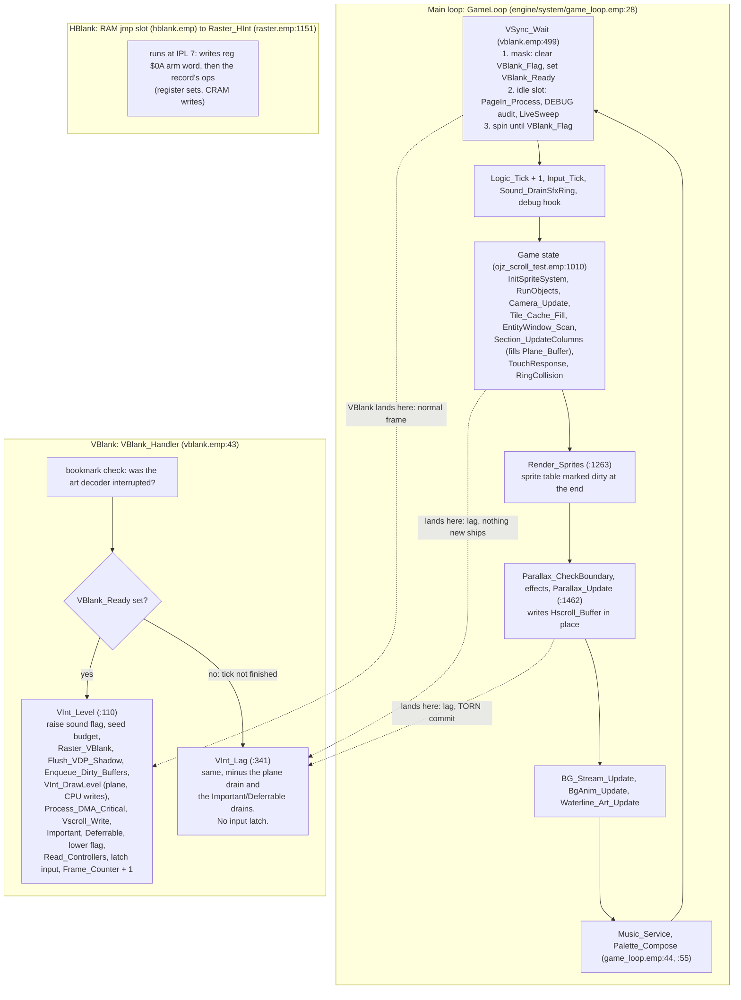

# Frame architecture: reviewer A

> [!verdict] Verdict: S3K level overall, uneven
> - **Best known, or better:** the Z80 keeps running through VBlank DMA, the three-priority DMA queue with a byte budget, the RAM-slot HBlank, the deterministic tick with input latching and replay, and the preemptible idle decoder.
> - **Below S3K in one decision: the lag frame.** S3K commits a safe subset on a lag frame. Aeon's `VInt_Lag` ships whatever the half-finished tick has produced so far: new sprites, a partly written HScroll table, and no plane update. Stage 2 measured this on 10 of 18 lag frames.
> - **The DMA budget is not sound.** It counts bytes, but the limit is cycles in vertical blank. The handler's fixed CPU cost is about three times what the budget's margin allows for, and plane bytes cost about 3.7 times what they are charged. The worst measured VBlank used 97% of blank while only 55% of the byte budget was spent. A frame that really used the budget would spill DMA into the picture (ESTIMATED, not yet observed).
> - **The engine has a lot of unused time.** The main loop spins idle for 31% to 62% of an average frame, while every lag frame comes from one single-tick spike. The idle slot exists but almost nothing is scheduled into it.
> - **For other games:** a 60 Hz shmup fits today. A 30 Hz game or a split-screen game does not, because the lag path is the wrong shape for both.

Labels: **MEASURED** = stage 2 ran it (`2-measurements.md`) or I derived it from stage 2's per-frame data and say so. **PUBLISHED** = cited. **ESTIMATED** = derivation shown. Code is cited as `path:line`. I did not read reviewer B's file, the 2026-11-13 engine review, or the merged audit.

Inputs: stage 1 (`1-research.md`) and stage 2 (`2-measurements.md`) were both present and marked done. I ran no emulator. I re-analysed stage 2's saved per-frame files (`measure/out/fp_*.json`) for one extra split, described in section 4.

---

## The frame as it runs today

The order inside one normal frame is: VBlank commits tick T's output and reads the pads, the main loop wakes and runs tick T+1 on that input, then idles. Tick T+1's picture is committed at the next VBlank.

### What a VBlank does, depending on where it lands

| VBlank lands while the main loop is in... | Path | What reaches the VDP | Consistent? |
|---|---|---|---|
| the `VSync_Wait` spin | `VInt_Level` | everything from the finished tick | yes |
| the idle art decoder (`ZX0R_Decompress`) | `VInt_Level`, then the decoder is banked (`vblank.emp:68-79`) | everything | yes |
| the idle audit or liveness sweep | `VInt_Level` | everything | yes (they touch no commit state) |
| the masked flag pair (`vblank.emp:515-518`) | cannot land: interrupts are off | | |
| the state, before `Render_Sprites` returns | `VInt_Lag` | HScroll re-sent (old, complete), VSRAM (old), palette if the raster program asks | yes: the old frame again. Costs 6.5k to 8.4k cycles (MEASURED) |
| inside `Render_Sprites` | `VInt_Lag` | as above; `Sprite_Emit_Active` holds the sprite table back (`buffers.emp:466`) | yes |
| after `Render_Sprites`, up to the end of `Parallax_Update` | `VInt_Lag` | **new sprite table, HScroll part new and part old, VSRAM possibly mixed, old plane, new sprite art not sent** | **no.** 10 of 18 lag frames (MEASURED) |
| after `Parallax_Update` (BG stream, music, `Palette_Compose`) | `VInt_Lag` | new sprites, HScroll and VSRAM against the old plane; palette possibly mid-compose | **no.** 0 of 18 measured, but `Palette_Compose` alone peaked at 27,292 cycles in one tick (MEASURED) |

---

## 1. Requirements

**What the frame architecture must do**

| For | Requirement | Met today? |
|---|---|---|
| Sonic 4 slice | 60 Hz with no lag on the fixed legs; commit plane, sprites, scroll and palette as one consistent picture; raster splits stable to the line; sound unaffected by DMA | Mostly. 18 lag frames in about 12,000 (MEASURED). The lag frames are not consistent pictures |
| Mega-acts, infinite levels | Streaming (art pages, tile blocks, plane rows) must be spread over frames and must never be the cause of a lag frame; teleports must not freeze the machine | Partly. Art decode is sliced into idle time. Tile-block fill is not, and it is the cause of every measured worst tick |
| A non-Sonic game | A game supplies its own states and its own per-frame order without editing engine files | Partly. See below |

**Named non-Sonic games**

- **A MUSHA-class vertical shmup** (60 or more bullet sprites, two planes with per-line scroll, boss art streamed in, a hard 60 Hz). It fits. `Game.entry` and `Game_State` give it its own loop, the sprite table DMA ships only live entries, the DMA queue's priorities suit "bullets first, boss art when there is room", and the deterministic tick plus replay gives attract mode and score replays for free. What it gets that it does not want: `VInt_Level` always calls level-engine pieces (`VInt_DrawLevel`, `Vscroll_Write` through the parallax module, the page-in staging check), about 0.5k cycles of no-ops per VBlank (ESTIMATED from the measured idle costs of those calls). What it lacks: the lag frame would show bullets displaced against the background.
- **A 30 Hz logic game** (a heavy strategy or pseudo-3D game that plans to take two frames per tick). It does not fit. There is one tick per VBlank and no "present every second frame" mode. Every other VBlank would take the lag path, which for this game is the normal path, and that path ships half-built sprite and scroll state. It also has no input latch on that path (correct for lag, wrong for a planned 30 Hz).
- **A split-screen two-player game.** It does not fit without new work. It needs the sprite table and scroll tables switched at a raster line. The raster system can set registers at a line, but there is one sprite buffer and one HScroll buffer, and the lag problem doubles. S3K's own two-player mode needed page-flipped sprite tables for exactly this (PUBLISHED, `sonic3k.asm:622-624`, via stage 1).

**Budget targets** (my proposal; the docs set none for this system)

| Resource | Target | Today |
|---|---|---|
| VBlank handler, worst case | finish by 90% of blank (16.7k cycles NTSC) | 97% worst (18,052, MEASURED) |
| VBlank handler, fixed cost before any art moves | 4k cycles | 3.6k to 7.9k, mean about 5k to 6k (MEASURED-derived, section 4) |
| Lag frames on the fixed legs, release | 0 | 2 (spindash leg, MEASURED) |
| Lag frame cost | under 3k cycles | 6.5k to 8.4k (MEASURED) |
| RAM | under 5 KB | 4,243 B (section 2) |
| ROM | not a constraint | about 2.5 KB |

**Worst case it must survive:** a diagonal top-speed camera move with a raster program armed, a palette fade running, a character art change and an art page landing in the same frame, and a tick that overruns. Today that combination is survivable only because demand has stayed low: nothing stops it from exceeding blank.

**Interfaces:** the game state (owns the order of work inside a tick), DMA producers (`QueueDMA_*`), the plane buffer, the raster system (owns HBlank and reg `$0A`), the sound driver (the DMA-window flag and the mailboxes), page streaming (the idle slot and the bookmark), replay (`Input_Tick`).

**Non-goals:** PAL speed compensation (owner ruling 2026-08-02, `boot.emp:316`), variable time step.

---

## 2. Inventory from source

**Call graph.** Boot ends by storing `Game.entry` into `Game_State` (`boot.emp:381`) and sets `VInt_Ptr` to `VInt_Level` (`boot.emp:313`). After that the diagram at the top is the whole graph.

| Feature | Class | Where |
|---|---|---|
| `GameLoop`, one tick per VBlank | SHIPPED | `engine/system/game_loop.emp:28` |
| `Logic_Tick` (lag-immune tick counter) | SHIPPED | `game_loop.emp:30` |
| `Input_Tick` live and playback | SHIPPED | `engine/system/replay.emp:143` |
| `Input_Tick` record, and the desync trap | DEBUG-ONLY | `replay.emp:148`, `:226`, desync trap `:217` |
| `Game.debug_tick` hook | INERT in canonical builds (bound only in the sound test shape) | `game_loop.emp:40` |
| `GameState_Idle` | INERT (no reference outside its own file) | `game_loop.emp:62` |
| `Game_State_ID`, `Region_Flags`, `Hardware_Region` | INERT (written at boot, never read) | `boot.emp:320-322`, `:382` |
| `VInt_Ptr` dispatch | SHIPPED, but only ever holds `VInt_Level` | `vblank.emp:83`, `ojz_scroll_test.emp:979` |
| `VInt_Menu`, `VInt_Load`, the eleven-state table, pause | ABSENT (doc only) | `docs/ENGINE_ARCHITECTURE.md` §1.4, §9.13 |
| Lag detection (`VBlank_Ready`) and `VInt_Lag` | SHIPPED | `vblank.emp:81-87`, `:341` |
| `Lag_Frame_Count` | DEBUG-ONLY. Release has no lag counter at all | `vblank.emp:475` |
| Art-decode bookmark | SHIPPED, but made 0 calls on every measured leg (OJZ is fully resident) | `vblank.emp:68-79` |
| Idle slot: `PageIn_Process`, `PageCache_LiveSweep` | SHIPPED | `vblank.emp:526`, `:542` |
| Idle slot: `PageCache_Audit` | DEBUG-ONLY | `vblank.emp:532-535` |
| Scanline gate on idle work (reads the V counter) | SHIPPED for the sweep, DEBUG for the audit | `engine/level/page_cache.emp:1275-1280`, `:2031` |
| DMA queue: Critical (8), Important (12), Deferrable (12) | SHIPPED | `engine/system/dma_queue.emp`, `engine/system/constants.emp:387-389` |
| Byte budget per VBlank, enqueue byte cap | SHIPPED | `vblank.emp:142`, `dma_queue.emp:140-145` |
| `DMA_Bytes_ThisFrame` | dead: cleared, never written or read | `vblank.emp:550` |
| Peak instruments (`DMA_Peak_Important`, straddle counters, `Plane_Buffer_Peak`) | DEBUG-ONLY | `vblank.emp:251-268`, `plane_buffer.emp:765` |
| Static commit entries (4 palette lines, ship, sprites, HScroll) | SHIPPED | `engine/system/buffers.emp:107`, `:301` |
| `PlaneMapToVRAM` | INERT (no caller) | `buffers.emp:210` |
| `Set_VDP_Reg` | INERT (no caller; its own header says so) | `engine/system/vdp_init.emp:114` |
| `Flush_VDP_Shadow`, all 19 registers every VBlank | SHIPPED | `vdp_init.emp:73` |
| Plane drain by CPU writes | SHIPPED | `engine/level/plane_buffer.emp:705` |
| `Plane_Buffer_Reset` | DEBUG-ONLY caller | `plane_buffer.emp:48` |
| HBlank RAM slot, install and uninstall | SHIPPED | `engine/system/hblank.emp:57`, `:75` |
| Raster walker (`Raster_VBlank`, `Raster_HInt`) | SHIPPED | `engine/effects/raster.emp:1009`, `:1151` |
| Display-off blanking to extend the DMA window | ABSENT | stage 1 grep; I found none either |
| Sound: flag bracket instead of stopping the Z80 | SHIPPED | `vblank.emp:128-132`, `:291-295` |
| Sound: one SFX per tick, music at most one request per tick | SHIPPED | `engine/sound/sound_api.emp:408`, `:476` |
| Controllers: full 6-button burst on both ports every VBlank | SHIPPED | `engine/system/controllers.emp:38` |
| PAL: region-selected DMA budget only | SHIPPED (NTSC-only product ruling) | `boot.emp:316-331` |

**Data formats.** `DMAEntry` is 14 bytes: VDP register numbers pre-filled, values interleaved, drained as a straight byte stream (`dma_queue.emp:1-5`). Plane buffer entries are `[addr.w][flags|count.w][data]` (`plane_buffer.emp:697-701`). Neither comes from a tool.

**Footprint** (MEASURED from `s4.lst`, release, built 2026-11-13)

| | Bytes | Notes |
|---|---|---|
| ROM, frame path | about 2,510 | `VInt_Level` 262, `VInt_Lag` 104, `VBlank_Handler` 72, `VSync_Wait` 50, `GameLoop` 30, `Enqueue_Dirty_Buffers` 498, `Process_DMA_Critical` 206, `Read_Controllers` 270, `Raster_HInt` 338, `Raster_VBlank` 106, `VInt_DrawLevel` 108, `Vscroll_Write` 118, `Input_Tick` 110, and six smaller routines |
| RAM | 4,243 | plane buffer 1,536, HScroll 896, sprite table 640, DMA queue 448, raster buffers 256, palette 128 + ship snapshot 128, static entries 98, VSRAM columns 80, shadow 19, SFX ring 8, HBlank slot 6 |
| VRAM | none of its own | |

**Build shapes that change behaviour**
- `DEBUG`: adds the audit to the idle slot and to the state, the canopy probe, hotkeys, asserts and peak latches in VBlank. Average logic is about 10k to 12k cycles a tick higher than release (MEASURED: idle 47.9k against 37.8k; spindash 59.2k against 46.8k). Lag differs: 6 against 2 on the same spindash leg.
- `SOUND_DRIVER_ENABLED == 0`: the Z80 is held for the whole VBlank pipeline instead of the flag bracket (`vblank.emp:137`).
- PAL hardware: a different budget constant, nothing else.

**Doc claims to check in section 7**

1. §1.4 step 3: `Flush_VDP_Shadow` "writes only dirty VDP registers".
2. §1.4 step list: the order of `VInt_Level`.
3. §1.4 step 6: Critical drain "~514 cycles".
4. §1.4 lag frames: "player never sees visual glitches".
5. §1.4: "each step is independently skippable without corrupting state".
6. §1.4 step 7 and §1.7: VSRAM is "4 bytes"; per-column would be "40 columns × 4 bytes = 160 bytes".
7. §0.8: PAL has 312 lines and about 72 blank lines; DMA budget derivation and its 0.89 margin.
8. §9.13: the `GameLoop` listing and the eleven-state table.
9. `vblank.emp:370-372`: the palette and sprite enqueues on the lag path "ARE safe".
10. `vblank.emp:519-523`: a mid-decode VBlank "always dispatches VInt_Level (never VInt_Lag)".
11. `engine/system/constants.emp:762-764`: the 0.89 margin covers the uncharged VBlank tail and the plane drain's rate.
12. `tile_cache.emp:1575-1577`: "a beam-position read cannot gauge frame load".
13. §9.4 / `ENGINE_ARCHITECTURE.md:5611`: logic is deterministic on `Logic_Tick`.

---

## 3. Best known approach

Stage 1 covers this well and I accept its seven-decision framing (D1 to D7) and its sources. I add three points and challenge one.

**Where Aeon sits on stage 1's scorecard**

| Decision | Best known (stage 1) | Aeon | My placing |
|---|---|---|---|
| D2 VBlank dispatch | function pointer (S.C.E.) | function pointer, one handler exists | S3K level |
| D3 lag commit | whole previous list (Vectorman) | **partial new state** | **below S3K**: the only design in the table that ships in-progress state |
| D4 commit build | precomputed, double-buffered list (Vectorman); 72 cycles/entry drain (S.C.E.) | precomputed static entries, 72 cycles/entry jump-table drain (`dma_queue.emp:336`), but plane rows by CPU | best known for the queue, S3K level for the plane |
| D5 overload bound | entries + bytes (Vectorman, SGDK) | entries + bytes on both the enqueue and drain side | best known in shape; the numbers are wrong (section 4) |
| D6 idle work | bookmark (S3K), cooperative task (SGDK) | bookmark for one job, scanline-gated sweeps | S3K level plus the scanline gate |
| D7 sound and bus | Z80 never stopped for DMA (MegaPCM 2) | flag bracket, sequencer on YM Timer A (`sound_constants.emp:146-160`) | best known |

**Additions**

1. **Plane updates by DMA.** S3K and Aeon write plane rows and columns with a CPU loop inside VBlank. SGDK's map engine sends them through its DMA queue, using the VDP's auto-increment of `$80` for columns (PUBLISHED: SGDK `inc/vdp_tile.h`, `VDP_setTileMapDataColumnFast` with the `DMA_QUEUE` transfer method; cited from memory, not re-fetched in this stage). A CPU copy costs about 7.5 cycles a byte (ESTIMATED: `move.l (a0)+,(a6)` 20 + `dbf` 10 per 4 bytes) against 2.38 for DMA.
2. **Deterministic tick.** No commercial Genesis engine in stage 1's set separates the logic tick counter from the VBlank counter. S3K's demo playback depends on frame-exact behaviour. Aeon's `Logic_Tick`, the VBlank-only input latch (`vblank.emp:299-322`) and the replay hash are ahead of the floor here.
3. **Unused idle time is the real gap.** Stage 1 lists "preemptible idle work" as one of four ideas. The measurement makes it the most valuable one: release spends an average of 70k to 79k cycles a tick spinning (MEASURED) and uses 0.37k of it.

**Challenge.** Stage 1 says Aeon's 6,144 B budget is "81.7% of the ceiling". The 7,524 B ceiling is what the VDP can move if the 68000 does nothing else in blank. An engine has to run its handler too. Against the ceiling Aeon can actually reach, 6,144 B is over 100% (section 4).

---

## 4. Hardware ceiling

I accept stage 1's first-principles numbers: 128,006 cycles a frame, 38 blank lines (18,566 cycles), 205 B a line in blank and 18 B a line in the picture, 2.38 cycles frozen per DMA byte.

**What binds:** cycles inside vertical blank, first. Not bytes.

**The VBlank cost model** (MEASURED-derived). From stage 2's per-frame files I split each `VInt_Level` call into DMA stall, plane drain and everything else:

| Leg | Fixed CPU (handler minus stall minus plane drain): mean, min to max | Worst call: total = stall + plane + fixed |
|---|---|---|
| release idle | 6,020 (5,956 to 6,426) | 10,270 = 3,758 + 86 + 6,426 |
| release spindash | 5,274 (3,648 to 7,866) | 14,818 = 3,502 + 3,506 + 7,810 |
| DEBUG spindash | 5,420 (3,740 to 7,938) | 16,070 = 8,086 + 1,474 + 6,510 |
| DEBUG diagonal | 4,932 (3,740 to 7,632) | 17,628 = 6,578 + 4,866 + 6,184 |

So: **VBlank cycles ≈ fixed (about 5k to 6k, up to 7.9k) + 2.3 × DMA bytes + plane drain (up to 7,004 cycles for at most 800 B, about 8.75 cycles a byte).**

The fixed part is `Raster_VBlank` (up to 1,856), `Enqueue_Dirty_Buffers` (up to 2,104), `Read_Controllers` (1,048), `Flush_VDP_Shadow` (698), the queue drain's own instructions, three Z80 bus brackets and the budget walk (all MEASURED, stage 2 table).

**What the budget assumes** (`engine/system/constants.emp:758-765`): 18,565 cycles ÷ 2.7 = 6,876 B, times 0.89 "for the uncharged non-DMA tail and the plane drain's rate" = 6,144 B. That margin is 11% of blank, about 2.0k cycles. The measured fixed cost is 5k to 7.9k, and plane bytes cost 8.75 where they are charged as 2.7.

> [!finding] The byte budget admits frames that do not fit in blank (ESTIMATED)
> `Read_Controllers` runs after the last DMA, so the DMA must finish by about cycle 18.5k with about 1.1k less fixed work in front of it.
> - **Typical fixed cost, no plane traffic, full 6,144 B of DMA:** 4.4k + 6,144 × 2.38 = 19.0k. About 0.5k cycles late, so about 200 B are still to send when the picture starts. In the picture DMA runs at 18 B a line, so the 68000 is frozen for about 11 lines.
> - **Worst fixed cost, 800 B of plane, the rest DMA:** 6.8k + 7.0k + 5,344 × 2.38 = 26.5k. About 8.0k cycles late, 3.3 KB still to send, the 68000 frozen for most of the picture, and every HBlank that frame arrives late.
> - **A budget that would be sound:** about 4.9 KB with no plane traffic, about 2.0 KB of DMA on a frame with 800 B of plane.
>
> This has not happened in any measured leg because demand peaked at 3,592 B. The closest frame used 97% of blank. A second player character, a boss, or a streaming act raises demand. See NEEDS-RUNTIME.

**Where the current design sits**

| Quantity | Now | Ceiling | Share | Label |
|---|---|---|---|---|
| VBlank cycles, average | 9.2k to 11.6k | 18,566 | 50% to 63% | MEASURED / ESTIMATED ceiling |
| VBlank cycles, worst | 18,052 | 18,566 | 97% | MEASURED |
| DMA bytes per VBlank, average | 1.15 to 1.43 KB | 7,524 | 15% to 19% | MEASURED / PUBLISHED |
| DMA bytes per VBlank, peak | 3,592 | 7,524 | 48% | MEASURED / PUBLISHED |
| Idle VBlank cost against the minimum for the same bytes | 8.8k | about 5.0k | 57% efficient | ESTIMATED: 1,154 B × 2.38 = 2.75k, plus drain 0.67k, VSRAM 0.18k, interrupt envelope 0.32k, pads 1.05k |
| Main-loop logic, average | 38k to 71k | about 109k outside VBlank | 35% to 65% | MEASURED |
| Main-loop logic, worst tick | 197k | 109k | 1.8× over | MEASURED |
| Idle spin, average | 40k to 79k a tick | | 31% to 62% of a frame unused | MEASURED |
| Blank extension by turning the display off | 0 lines | +205 B a line | unused | stage 1 |
| Input to first changed pixel | 1.0 to 1.9 frames | same floor for any VBlank-commit design | at the floor | ESTIMATED (stage 1) |
| PAL budget | 11,648 B | 17,622 B (V28) | 66% | constant / PUBLISHED |

---

## 5. Measured cost

Stage 2 owns this section and I have nothing to correct in its numbers. What I take from it:

- Lag is caused by single ticks, never by the average. Every worst tick is `Tile_Cache_Fill` (up to 109,602 cycles in one call).
- `VInt_Lag` costs 6.5k to 8.4k cycles. A lag frame happens because the tick is already late, and the lag handler then takes another 5% to 7% of a frame from it.
- The handler's fixed cost (my split, section 4) is the largest steady consumer of blank, larger than the DMA it exists to run on a calm frame.
- Not measured, and it matters for the verdict: an object-heavy leg, a sidekick, page decode in the idle slot, PAL, and the scanline at which VBlank work ends.

---

## 6. Correctness

### F1. The lag frame ships a torn picture (proven in code, MEASURED)

On a lag frame `VInt_Lag` still calls `Enqueue_Dirty_Buffers` and `Process_DMA_Critical` (`vblank.emp:362`, `:456`).
- The sprite table ships if `Render_Sprites` has finished (`buffers.emp:464-473`).
- HScroll ships on every VBlank from `Hscroll_Buffer` (`buffers.emp:23`, `:505-507`), the same buffer `Parallax_Update` fills in place (`engine/level/parallax.emp:4062`, `:4887`). There is no second copy.
- `Vscroll_Write` runs (`vblank.emp:457`) from cells the parallax step fills a word at a time.
- The plane drain does not run, correctly, because the buffer may be half-written (`vblank.emp:363-369`).
- The Important queue does not drain, and character art (DPLC) rides the Important queue (`vblank.emp:224-226`). So a new sprite frame can be shown with the previous frame's tiles.

Result: sprites at the new camera position over a background at the old one, with a scroll table that changes part-way down the screen. The camera had moved 6 to 16 px on the measured frames. The next complete frame repairs it.

The code comment calls this "one frame of mixed offsets, self-healing" (`vblank.emp:376-381`). That is accurate, but it is a worse answer than S3K's, which holds sprites and scroll on a lag frame.

*Test that fails first:* in the headless harness, force a lag (a breakpoint-held delay inside `Parallax_Update`), and at `VInt_Lag`'s `Process_DMA_Critical` assert that the Critical queue holds no sprite-table or HScroll entry. Today it holds both.

### F2. The budget can admit an overrun (ESTIMATED from measured parts)

Section 4. The plane drain is charged by byte count at the DMA rate (`vblank.emp:169-175`), and the comment that the margin absorbs the difference (`vblank.emp:171-173`) does not hold against the measured costs. When the budget is exceeded in cycles the result is not graceful: DMA continues into the picture at one eleventh of the speed with the 68000 frozen, raster splits slip, and the tick that follows starts late.

*Test that fails first:* a DEBUG latch that reads the V counter at the end of `VInt_Level` and keeps the peak, then a synthetic leg that queues 4 KB of Deferrable DMA on a diagonal-scroll frame. Assert the peak line is still in blank.

### F3. Game logic reads the VBlank counter (proven in code)

`Frame_Counter` advances on lag frames; `Logic_Tick` does not. Player physics reads `Frame_Counter`: flight fuel is spent on its odd values (`games/sonic4/player/player_fly.emp:271`), and two sound cadences use it (`player_fly.emp:430`, `player_glide.emp:691`). Fuel is gameplay state.

Why it matters: recording exists only in DEBUG (`replay.emp:148`), playback runs in release, and the two shapes lag differently (6 against 2 on the same leg, MEASURED). A recording that includes flight can play back differently. It also makes flight last longer or shorter depending on lag.

*Test that fails first:* a lint that fails on any `Frame_Counter` reference under `games/*/player` and `games/*/objects`. Then a replay fixture with flight and one injected lag frame, expecting the DEBUG desync trap.

### F4. The palette can ship half-composed on a lag frame (proven in code)

The lag-path comment says the palette enqueue is safe because the dirty flag "is set only after a complete write" (`vblank.emp:370-372`). But `Raster_VBlank` runs on the lag path too (`vblank.emp:359`) and sets the dirty bits itself from the program's mask on every VBlank (`raster.emp:1097-1098`). So with a raster program armed, `Palette_Buffer` is sent whether or not `Palette_Compose` is in the middle of writing it (`engine/effects/palette.emp:403` onward: base, cycling, fade and operators, each written in place).

The re-send cannot simply be dropped: mid-screen CRAM writes mean the top of the screen needs its colours restored every frame. The engine already keeps a copy of the last complete palette it shipped (`Palette_Ship_Snap`, `buffers.emp:321-330`). A lag frame could send that instead.

Severity: low (one frame of slightly wrong colours, only on a lag frame, only mid-compose). The comment is wrong.

*Test:* force a lag inside `Palette_Compose` during a fade with a band armed; CRAM at the next line 0 must equal either the pre-tick or the post-tick palette.

### F5. A decode that starts just before VBlank costs a whole frame (known, narrowed, not closed)

`PageIn_Process` checks `VBlank_Flag` before starting a decode (`engine/level/page_in.emp:165`). Between that check and the decoder's first instruction, a VBlank is not bookmarked (the PC is outside the decoder's range), runs `VInt_Level` and clears `VBlank_Ready`. The decoder then runs until the following VBlank, which is a lag frame. The handler's own header describes this and calls it benign (`vblank.emp:56-64`). It is one lost tick per occurrence. It could not be measured because no leg decoded a page. NEEDS-RUNTIME.

### F6. Smaller edges

| Edge | What happens | Verdict |
|---|---|---|
| Critical queue full | 7 of the 8 slots can be taken by the engine's own entries (4 palette, ship, sprites, HScroll). Palette and sprites retry next frame (`buffers.emp:307`, `:472`). The HScroll result is ignored (`buffers.emp:507`), so it is silently one frame stale | graceful |
| An Important or Deferrable entry larger than the frame's remaining budget | it waits, and everything behind it waits too (`dma_queue.emp:469`). The enqueue cap (12,288 B) is larger than the drain budget (6,144 B), so an entry can be accepted that can never drain. Only `bg.emp:622` pins its own chunk size | no engine-level pin; add one |
| Sprite art deferred by the budget | the sprite table (Critical) always ships; its tiles (Important) may not. One frame of wrong tiles under load | same class as S3K, but budget-dependent here |
| SFX latency | `Sound_DrainSfxRing` runs before the state (`game_loop.emp:33`), so a sound requested in tick T is posted in tick T+1, one per tick. On a lag frame it waits longer | works; one frame slower than it needs to be |
| HBlank against VBlank | `Raster_HInt` runs at IPL 7 (`raster.emp:1195`), so it delays VBlank by at most one handler body; VBlank at IPL 6 delays HBlank until it returns. With VBlank at 97% of blank, the two priming fires on lines 0 and 1 (`raster.emp:1119-1121`) have about one line of margin | NEEDS-RUNTIME under F2's overrun |
| Three Z80 bus holds per VBlank | raise flag, lower flag, pads (`vblank.emp:129`, `:292`, `controllers.emp:39`). The pad hold is about 1,048 cycles | works; two could be one |
| PAL | budget derived for 72 blank lines while the engine runs 224 lines (89 blank). Safe and under-used. Game speed is 5/6. Music tempo holds because the sequencer runs on YM Timer A | by ruling |
| DEBUG against release | different lag, so anything keyed to `Frame_Counter` differs between shapes (F3) | see F3 |
| Full plane redraw | masks interrupts for about three frames (`engine/level/section.emp:322-326`). Only level init and the DEBUG warp trigger it, both straight after a display-off cache fill (`section.emp:853-856`) | fine today; an in-play teleport would need a sliced version |

`VSync_Wait`'s masked flag pair (`vblank.emp:515-518`) and the VBlank-only input latch are correct and well reasoned. I found no race in the queue: every main-loop enqueue is masked (`dma_queue.emp:126-127`) and the static enqueues run only inside VBlank (`buffers.emp:44-48`).

---

## 7. Code quality

**Claims checked** (numbering from section 2)

| # | Claim | Result |
|---|---|---|
| 1 | Flush writes only dirty registers (§1.4 step 3) | **False.** It writes all 19 every frame (`vdp_init.emp:73-83`). §1.7 of the same doc says so |
| 2 | `VInt_Level` step order (§1.4) | **Incomplete.** `Raster_VBlank` (`vblank.emp:163`) is missing, and it is order-critical |
| 3 | Critical drain "~514 cycles" | **Stale.** The code says 670 worst (`dma_queue.emp:336-349`). With DMA stall it is 2.5k to 3.4k (MEASURED) |
| 4 | Lag frames: "player never sees visual glitches" | **False.** F1 |
| 5 | "Each step is independently skippable without corrupting state" | **False as a statement about the picture.** Skipping the plane drain while shipping sprites and scroll is F1 |
| 6 | VSRAM is 4 bytes; per-column would be 160 bytes | **Stale.** The per-column path ships and writes 20 longwords, 80 bytes (`vblank.emp:389-393`) |
| 7 | PAL: 312 lines, 72 blank lines | **Wrong for the mode the engine runs.** 313 lines, 89 blank at 224 lines (PUBLISHED, stage 1) |
| 8 | §9.13 `GameLoop` listing and state table | **Stale and aspirational.** The real loop has six more steps (`game_loop.emp:28-56`). None of the eleven states exists; the only state constants are `GS_BOOT` and `GS_IDLE` |
| 9 | Lag-path palette enqueue is safe (`vblank.emp:370-372`) | **False** when a raster program is armed. F4 |
| 10 | A mid-decode VBlank always takes `VInt_Level` (`vblank.emp:519-523`) | **Contradicted 460 lines up** by the handler's own header (`vblank.emp:55-64`), which is the correct one |
| 11 | The 0.89 margin covers the tail and the plane rate (`engine/system/constants.emp:762-764`) | **False against measurement.** Section 4 |
| 12 | A beam read cannot gauge frame load in `Tile_Cache_Fill` (`tile_cache.emp:1575-1577`) | **Doubtful.** The fill runs in the main loop after VBlank returns. The V counter there says how many lines remain before the next VBlank, which is exactly the deadline. The idle sweep already gates on it |
| 13 | Logic is deterministic on `Logic_Tick` | **Mostly.** F3 is the exception |

**Other observations**

- **Comment weight.** `vblank.emp` is 553 lines of which 169 are code. Much of the rest is the history of past mistakes (dated corrections, deleted lines explained at length). The reasoning is valuable, but the current rule is hard to find under it. `vblank.emp:384-455` spends 70 lines explaining why one deleted instruction is not needed. That belongs in a decision record with a two-line pointer.
- **The shipped game's frame order lives in a test file.** `games/sonic4/test/ojz_scroll_test.emp` is 4,570 lines and holds the real per-frame order plus debug hotkeys and readouts. The order of the fifteen calls is what creates F1, and nothing states it as a contract.
- **The engine has no notion of frame phases.** Each state must call `InitSpriteSystem`, `RunObjects`, `Render_Sprites` and the rest itself, in the right order. The demo does (`games/demo/demo_state.emp:68-71`). A new game's developer can follow the demo, but nothing tells them which orders are safe.
- **Level code inside the system VBlank.** `VInt_Level` calls `VInt_DrawLevel`, `Vscroll_Write` and reads `PageIn_Staging_Busy` unconditionally. A game with no level pays for them and cannot remove them except by writing its own handler. `VInt_Lag` cannot be replaced at all (`vblank.emp:87`).
- **Dead or inert:** `DMA_Bytes_ThisFrame`, `GameState_Idle`, `Game_State_ID`, `Region_Flags`, `Hardware_Region`, `PlaneMapToVRAM`, `Set_VDP_Reg`.
- **Gates.** The only cycle budget in the tree is `@budget(cycles: 670)` on `Process_DMA_Critical` (`dma_queue.emp:358`). It counts instructions and not the DMA stall, which is three to four times larger. Nothing gates the whole VBlank, the lag commit, or lag counts on the fixed legs. The Z80 bus-hold census and the palette census are good, real gates.
- **Facts that should be generated from code:** the `VInt_Level` step list in §1.4 and §0.10, the budget derivation, and the state table.
- **Release cannot report lag.** Stage 2 had to count `VInt_Lag` calls with a profiler. One byte and 16 cycles on the lag path would fix that.

---

## 8. Verdict and plan

> [!verdict] S3K level
> Three parts are at best known (sound and bus, the queue, determinism and input). One part is below the floor (the lag frame). The budget is the right idea with the wrong numbers. The biggest opportunity is not in VBlank at all: it is the idle time.

**Ranked improvements**

| # | Change | Gain | Cost | Risk | Depends on | Bytes change? |
|---|---|---|---|---|---|---|
| 1 | **Lag frame commits only the last complete picture.** In `VInt_Lag`: keep `Raster_VBlank`, the register flush and the pads; send the palette from `Palette_Ship_Snap`; send no sprites, no HScroll, no VSRAM (the VDP still holds last frame's) | Removes F1 and F4. Saves most of the 6.5k to 8.4k a lag frame costs (ESTIMATED 4k to 5k: the 896 B HScroll DMA alone is 2.1k), which shortens the overrun that caused it | small: about 20 lines | low. The owner may prefer scroll to keep moving on lag frames (The Chaos Layer's choice); that needs a complete HScroll copy and is item 9 | none | yes |
| 2 | **Count the budget in cycles.** Charge plane bytes at their real rate, set the base from the measured fixed cost (about 4.9 KB, less with plane traffic), and add a DEBUG latch of the scanline where `VInt_Level` ends | Closes F2 before content reaches it; turns an estimate into a number every build can report | small | low. Lower budget means art lands a frame later under load | NEEDS-RUNTIME item 1 to confirm | yes |
| 3 | **Move speculative tile-cache work into the idle slot as a second preemptible job.** The slot and the bookmark exist; make block decode resumable the way the art decoder is, and give the slot a short priority list | Attacks the cause of all 18 lag frames using time that is already free (40k to 79k cycles a tick) | large | medium: a second bookmarked routine, and the cache must tolerate a half-filled column | the tile-cache audit | yes |
| 4 | **Plane rows and columns by DMA** instead of a CPU loop | ESTIMATED 3k cycles off the worst VBlank (7.0k to about 4k): per entry about 150 cycles of setup, then 2.38 instead of 7.5 cycles a byte | medium | medium: auto-increment excursions move into the drain | item 2's latch to measure it | yes |
| 5 | **Take `Frame_Counter` out of game logic** and add the lint | Closes F3; replays valid across shapes | tiny | changes flight fuel timing only on lag frames | none | yes |
| 6 | **Post the SFX from VBlank inside the existing flag-raise bus hold; lower the flag inside the pad hold** | One bus hold fewer per VBlank, one fewer in the main loop, SFX one frame sooner and immune to lag | small | low; the mailbox rule (post only when empty) stays | none | yes |
| 7 | **A lag counter and a peak VBlank-end line in release** | Lag becomes reportable without a profiler; a player-visible meter becomes possible | tiny | none | none | yes (a few bytes) |
| 8 | **Engine-owned frame phases.** A small contract (update, render, post-render hooks) so the engine, not each state, owns the order; move the shipped state out of `test/`; let a game choose its lag handler and a slim VBlank handler | Other games get a correct order for free; F1-class bugs become structural; non-level games save about 0.5k a VBlank | medium | low for behaviour, high for churn | the engine/game contract audit | yes |
| 9 | **Double-buffer the commit set** (sprite table and HScroll, about 1.5 KB of RAM), flipped at tick end | Needed only if the owner wants a 30 Hz mode, split screen, or scroll that keeps moving on lag frames | medium | low | item 1 first | yes |
| 10 | **Trim the fixed VBlank cost**: skip port 2 when the game declares one player (about 500 cycles and a shorter Z80 hold), skip the palette snapshot copies when no band is armed | about 0.5k to 1.2k a frame (ESTIMATED from the measured routine costs) | small | low | none | yes |
| 11 | **Fix the docs** listed in section 7; generate the step list from code | Trust | small | none | none | no |

**Beyond the state of the art**

| Candidate | What it is | Plausibility |
|---|---|---|
| One admission rule over cycles and bytes | At the top of VBlank, and before each idle job, decide from the V counter and a per-job cost table whether the job fits before its deadline. The idle sweep already does a fixed-line version of this (`page_cache.emp:1275`). Nobody ships it for the commit itself | high. Item 2 is its first half |
| A priority list of preemptible jobs | Item 3 generalised: decode, block fill, sweeps, and later AI, each resumable, run in priority order in the idle slot | high. One job type already works |
| Catch-up tick after a lag | Run two logic ticks in the frame after a lag, drawing only the second, so game speed holds. The deterministic tick makes this possible, and the measured spikes are streaming, not logic (`RunObjects` is about 11k) | medium. Needs a logic-only tick that skips streaming and render |
| Letterbox sized to DMA debt | Blank a few bottom lines by HBlank only on frames whose queue would otherwise overrun, about 205 B a line (stage 1) | medium. It must share HBlank with the raster system, and the black band is visible. Useful for a boss entrance or an act crossing |
| Late input latch | Run idle jobs first and read the pads as late as the measured tick cost allows, cutting latency by up to half a frame | low to medium. The tick cost varies from 38k to 197k, so the safe delay is small |

**Dropped, with reasons**

- **SGDK's main-thread commit.** A late tick commits late and tears mid-screen. Worse than a held frame.
- **Stopping the Z80 for the whole VBlank.** Aeon is already past this.
- **Bringing back the dirty mask for the register flush.** Saves about 0.5k but the blanket restore is a deliberate composability choice (`vdp_init.emp:40-47`). Not worth reopening.
- **Double buffering as the fix for F1.** It gives nothing that item 1 does not, unless the owner wants item 9's features.
- **HBlank on every line as a load meter.** 13% to 26% of the frame (stage 1, ESTIMATED).

**Decisions that are the owner's**

1. On a lag frame, should the screen hold completely (item 1, S3K's answer), or should scroll keep moving with sprites held (needs item 9)?
2. Is a 30 Hz mode or split screen in scope for the engine? If yes, item 9 moves up.
3. Is a visible letterbox ever acceptable, for set pieces?
4. Should the shipped game state move out of `test/` now or with the engine/game contract audit?
5. May the engine skip the second pad for one-player games?
6. PAL remains NTSC-only by the 2026-08-02 ruling. The engine is safe on PAL but 5/6 speed. Confirm this still holds for "reusable for other games".

**NEEDS-RUNTIME (for the controller)**

1. The scanline at which `VInt_Level` ends on the worst frame, and a synthetic leg that fills the budget, to turn F2 from ESTIMATED into MEASURED.
2. What the F1 frames look like on screen, including whether a sprite shows the wrong tiles.
3. Page decode in the idle slot on a streaming act: preempt counts and whether F5's lost frame occurs.
4. An object-heavy leg and a sidekick leg. No verdict on scaling is possible without them.
5. PAL boot: lag, budget use, raster line positions.
6. Whether the two priming HBlank fires survive a VBlank that ends on line 0 or later.
