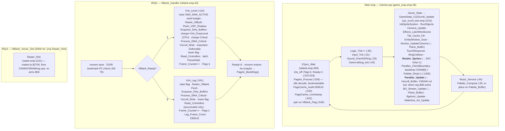

# Frame architecture: reviewer B

> [!verdict] Conclusion
> **S3K level overall. Several mechanisms are at or past the best known. Two are below the floor.**
>
> **Ahead of S3K:**
> - The Z80 is never halted for DMA (MegaPCM-2 flag bracket).
> - Idle-time art decode is preemptible by PC-range bookmark (S3K's best trick, rebuilt).
> - Input is latched once per tick, and press edges survive lag frames.
> - The DMA queue is three-tier, with an entry and byte dual cap.
> - Lag detection is race-free.
>
> **Below S3K:**
> 1. **The lag frame commits a torn mix.** `VInt_Lag` ships the new-camera sprite table and an HScroll buffer that `Parallax_Update` has only partly written, against planes that were not drained. Stage 2 measured this on **10 of 18** lag frames. S3K ships no sprites or scroll on a lag frame, and Vectorman ships the whole previous frame.
> 2. **The VBlank byte budget does not bound the window.** It charges the CPU-written plane drain at DMA rate, though the drain really costs about 3.4× that. It also charges nothing for about 6k cycles of fixed VBlank work. On a frame where plane, Critical and Important are all at their designed peaks, the budget admits about 3 KB more than the blank can carry. The spill then freezes the 68000 for most of the next frame (ESTIMATED; NEEDS-RUNTIME).
>
> **The best cheap wins, ranked in §8:**
> 1. Make the lag commit coherent.
> 2. Charge the budget in cycles, or by reading the HV counter.
> 3. Put Critical DMA ahead of the plane drain.
> 4. Delete the mid-frame direct reg `$0B` write.
> 5. DMA the plane buffer instead of CPU-writing it.

Labels: **MEASURED** = I ran it, or cite the aeon doc that did (mostly [[2-measurements]]). **PUBLISHED** = cited source (mostly [[1-research]]). **ESTIMATED** = derivation shown. I ran no emulator. Every runtime number is cited from stage 2.

---

## 1. Requirements

### What the frame architecture must do

| Consumer | Requirement |
|---|---|
| **Sonic 4 vertical slice** | Keep 60 Hz on NTSC through top-speed diagonal motion with plane streaming, character DPLC, parallax with per-line HScroll, raster splits (water line, bands), palette fades and region crossings. A lag frame must look like a *held* frame, never a wrong one. Sound must never stall. |
| **Mega-acts / infinite levels** | Per-frame cost must not grow with act size. Long jobs (page decode, residency sweep) must run in idle time and be preemptible. Counters must survive wrap: `Frame_Counter` is u16 and wraps in about 18 min (ESTIMATED: 65,536 / 59.92 Hz). Overload must degrade gracefully (defer art), not cascade. |
| **Named non-Sonic game: a vertical shmup with 50+ sprites** (a Thunder Force IV / M.U.S.H.A.-class game) | Ship a full 80-entry SAT every frame. Hardware-scroll a plane per line without a "parallax" concept. Run bursty sprite-art DMA (explosions) under a byte cap. Keep frame pacing steady under bullet spikes. Optionally run logic at 30 Hz with 60 Hz presentation. |

**What this architecture would do for that shmup today** (from source):
- **The SAT path works.** `Static_Sprite_DMA` ships 640 B whenever `Sprite_Table_Dirty` is set (`engine/system/buffers.emp:464-473`).
- **HScroll is not shipped unless a *parallax config* is active.** `Enqueue_Dirty_Buffers` gates the HScroll entry on `Parallax_Active_Config` (`buffers.emp:505-507`). A shmup that fills `Hscroll_Buffer` itself gets nothing on screen, unless it adopts the level/parallax module or hand-queues a Critical entry every frame. The engine's *system* layer depends on a *level* module for a basic VDP commit.
- **The VBlank is monolithic.** `VInt_Ptr` has exactly one target in the tree (`boot.emp:313`, `ojz_scroll_test.emp:979`). A shmup gets the plane-buffer charge, `Raster_VBlank`, the residency-staging release and the parallax lookups whether it needs them or not. The cost is small, but the coupling is real.
- **30 Hz logic loses input.** If a state calls `VSync_Wait` twice per tick, both VBlanks run `VInt_Level`. Each one *overwrites* `Ctrl_x_Press` from the accumulator and clears it (`vblank.emp:304-312`). A press latched at the first VBlank is gone before logic reads it at the second. No frame-divider exists in `GameLoop` (`game_loop.emp:28-57`).
- **Under bullet spikes it slows down** (one tick per VBlank, no catch-up), like every Genesis game. On lag frames it ships the new SAT against stale scroll (§6 F1).

### Budget targets (my proposal; the docs state none for the frame as a whole)

| Resource | Target | Basis |
|---|---|---|
| VBlank CPU, NTSC | ≤ 90% of ~18,566 cycles (≈ 16.7k) on the worst designed frame, **guaranteed by construction** | blank = 38 × 488.6 (PUBLISHED via [[1-research]] §4.1) |
| VBlank DMA | whatever fits after the fixed commit (1,744–1,792 B) | [[1-research]] §4.3; `bg.emp:591` |
| Main-loop logic | avg ≤ 60%, worst tick ≤ 100% of 128,006 | MEASURED today: avg 30–56%, worst 154% ([[2-measurements]] §b) |
| HInt | ≤ 2% when sparse | MEASURED 0.7–1.2k/tick |
| RAM | frame buffers about 4 KB (today 3,856 B, §2) | |

### Worst case it must survive

Top-speed diagonal motion. On that frame the plane-buffer peak (800 B = 2 FG columns + 2 FG rows + 2 BG rows; `bg.emp:548-557`), a full Critical queue (4 palette lines + SAT + HScroll + off-screen ship = 1,792 B; `bg.emp:591`), a 2 KB page landing plus a character DPLC in Important, and a raster program armed all coincide, with a sidekick and 30 objects.

**Interfaces:** DMA queue producers (DPLC, page-in, bg_anim, BG stream), plane-buffer producers (Section_UpdateColumns, BG_Stream_Update), raster/effects (HInt ownership, palette dirty), sound mailbox, replay seam, game contract (`Game.entry`).
**Non-goals:** PAL timing compensation (owner ruling 2026-08-02, `boot.emp:316-319`), V30.

---

## 2. Inventory from source

### Call graph and per-frame order of work

### Feature classification

| Feature | Class | Where |
|---|---|---|
| Main loop, one tick per VBlank | SHIPPED | `game_loop.emp:28-57` |
| `VInt_Ptr` mode dispatch | SHIPPED, single target (`VInt_Level` only); `VInt_Menu`/`VInt_Load` ABSENT (doc says "Planned") | `boot.emp:313`, `vblank.emp:83` |
| Lag detection (`VBlank_Ready`) with masked arm | SHIPPED | `vblank.emp:81-82`, `:515-518` |
| `VInt_Lag` reduced commit | SHIPPED | `vblank.emp:341-479` |
| ZX0R VBlank bookmark | SHIPPED, but no OJZ caller exercises it (stage 2: 0 decode calls) | `vblank.emp:68-79` |
| Idle slot: PageIn_Process, LiveSweep | SHIPPED | `vblank.emp:526`, `:542` |
| Idle slot: PageCache_Audit | DEBUG-ONLY | `vblank.emp:532-535` |
| Three-tier DMA queue (8/12/12 slots), Ultra-style Critical jump table | SHIPPED | `dma_queue.emp:359-411`, `constants.emp:387-389` |
| Window byte budget (`DMA_Budget_*`) for Important/Deferrable | SHIPPED | `vblank.emp:142-204`, `dma_queue.emp:461-500` |
| Enqueue byte cap 12,288 | SHIPPED (never binds in practice; it sits above the window) | `dma_queue.emp:136-145`, `constants.emp:786` |
| Lag-history feedback budget | ABSENT (doc says so honestly) | ARCH:1203 |
| Plane buffer CPU drain in VBlank | SHIPPED | `plane_buffer.emp:705-762` |
| VDP register shadow, all 19 regs flushed every VBlank | SHIPPED | `vdp_init.emp:20-30` |
| RAM HBlank trampoline + raster walker | SHIPPED | `hblank.emp:57-82`, `raster.emp:1009-1150` |
| Z80 flag bracket (never halted for DMA) | SHIPPED (sound build) | `vblank.emp:128-131`, `:291-295` |
| 6-button read with Z80 halted, every VBlank | SHIPPED | `controllers.emp` |
| Replay seam `Input_Tick` | SHIPPED (record is DEBUG) | `game_loop.emp:31`, `replay.emp` |
| SFX ring, one post per tick | SHIPPED | `sound_api.emp:344-431` |
| `Music_Service` after state | SHIPPED | `game_loop.emp:44` |
| PAL budget selection | SHIPPED (budget only; no timing compensation) | `boot.emp:320-331` |
| `DMA_Bytes_ThisFrame`, `DMA_Peak_Critical`, `DMA_Peak_Deferrable` | INERT: declared, never accumulated (the first is only zeroed, `vblank.emp:550`) | `ram.emp:954-957` |
| `Set_VDP_Reg` | SHIPPED, used for the base-register reassert | `vdp_init.emp:33` |
| Lagometer (window-plane / raster bars) | ABSENT in code (ARCH §8 lists a "frame profiler") | ARCH:23 |

### Footprint (from `s4.lst`, release, 2026-11-13 build)

| Item | Bytes | Source |
|---|---|---|
| `VBlank_Handler` / `VInt_Level` / `VInt_Lag` / `VSync_Wait` code | 72 / 262 / 104 / 98 | symbol deltas `$2328/$2370/$2476/$24DE/$2540` |
| DMA queue RAM (32 × 14) | 448 | `DMA_Queue $FF804A … $FF820A` |
| `Sprite_Table_Buffer` | 640 | `ram.emp` |
| `Hscroll_Buffer` (single) | 896 | `ram.emp:443` |
| `Plane_Buffer` | 1,536 | `ram.emp:1078` |
| `Palette_Buffer` + `Palette_Ship_Snap` | 256 | |
| `Parallax_Vscroll_Column_Buf` | 80 | `ram.emp:528` |
| Raster A/B working buffers | 256 | `ram.emp:747-748` |
| **Total frame-commit RAM** | **≈ 4,112** | sum |

### Build shapes that change behaviour

| Flag | Effect |
|---|---|
| `SOUND_DRIVER_ENABLED=0` | Z80 is halted across the whole VBlank pipeline instead of the flag bracket (`vblank.emp:137`) |
| `DEBUG=1` | Adds the idle-slot `PageCache_Audit`, the `VInt_DrawLevel` IPL assert, peak counters and `Lag_Frame_Count`. Measured lag goes from 2 to 6 on the spindash leg ([[2-measurements]]). |
| `SOUND_DBG_MIRROR` | Adds a ~190 µs Z80 stop in every VBlank (`vblank.emp:89-92`). Off-canonical shape. |
| `Game.SCANLINE_CAPS & CAP_PER_COL_VSRAM` | Enables the 80-B VSRAM column write (`parallax.emp:1760`) |
| Region (runtime) | `DMA_Budget_Default` = 6,144 or 11,648 |

### Doc and comment claims to check in §7

| # | Claim | Where |
|---|---|---|
| C1 | VInt_Level order list (no `Raster_VBlank`) | `vblank.emp:101-103`; ARCH §1.4 step table |
| C2 | "Flush_VDP_Shadow — Writes only dirty VDP registers" | ARCH §1.4 step 3 |
| C3 | "Process_DMA_Critical … ~514 cycles" | ARCH §1.4 step 6 |
| C4 | VInt_Lag "Critical DMA only" | `vblank.emp:330` |
| C5 | Lag frame: "palette, sprites — player never sees visual glitches" | ARCH §1.4 lag bullets |
| C6 | "Each step is independently skippable without corrupting state" | ARCH §1.4 "Why this order" |
| C7 | "Visual stability first" ordering | same |
| C8 | VBlank "process sound" | ARCH §0.1 design decisions (`ENGINE_ARCHITECTURE.md:346`) |
| C9 | VSRAM: "4 bytes (FG + BG)" | ARCH §1.4 step 7 |
| C10 | Debug counters `DMA_Bytes_ThisFrame` (total bytes enqueued) and per-queue peaks | ARCH:1221 |
| C11 | Budget derivation "hardware-verified": 2.7 cyc/B, PAL 72 lines, 0.89 margin absorbs the uncharged tail and the plane CPU rate | `constants.emp:752-770` |
| C12 | Reg `$0B` direct write: "must be live for the frame it becomes active" | `parallax.emp:2025-2032` |
| C13 | "Thunder Force IV is the only holdout (ROM-based)" HBlank | ARCH §0.1 |

---

## 3. Best known approach

I accept [[1-research]] §3 as written. Its scorecard (§3.8) is the right frame. What follows places aeon in it and adds the points stage 1 did not make.

| Decision | Best known | Aeon | Placement |
|---|---|---|---|
| D2 VBlank dispatch | function pointer (S.C.E.) | pointer, one target | parity |
| D3 lag commit | Vectorman (whole previous list) / S3K (palette + HInt only) | **sprites + HScroll + VSRAM + palette + raster re-arm, from buffers mid-write** | **below S3K**: the only row in the table that ships a *mixed* frame (stage 1's "fifth row", now placed) |
| D4 commit build | Vectorman precomputed list + Ultra drain | static entries + Ultra-style Critical jump table + budgeted loop | at best known for the DMA part; **plane data is CPU-written** (S3K parity, below SGDK, which DMAs tilemap rows) |
| D5 overload bound | entries + bytes (Vectorman, SGDK) | entries + bytes + window budget | **best known in shape, broken in calibration** (§6 F2) |
| D6 idle work | S3K bookmark; SGDK task | PC-range bookmark for ZX0R + scanline-gated slices | at best known (S3K-class mechanism, more jobs); not a general scheduler |
| D7 sound/bus | MegaPCM 2 (never stop Z80 for DMA) | flag bracket; Z80 halted only for flag pokes and the ~1k-cycle pad read | at best known |
| Input | S3K VBlank poll | VBlank poll; edges accumulate across lag; publish only on complete VBlank | **beyond S3K**: S3K loses presses on lag frames |

**What stage 1 underplays:** SGDK's tilemap writes (`VDP_setTileMapDataRow` and friends) go through the DMA queue. On this hardware that is about 3.4× cheaper per byte than aeon's CPU drain (ESTIMATED in §4). Batman & Robin and S3K use CPU writes. The best known approach is DMA for any run of 64 B or more.

**A combination nobody ships, and aeon is unusually close to it:** an **atomic publish**. Aeon already builds every per-frame commit (SAT, HScroll, palette lines, off-screen palette ship) as a *static DMA entry whose source field is an address*. Double-buffering then needs only:
- a second copy of each buffer, and
- a `movep.l` that rewrites each static entry's source at the end of the tick.

That is Vectorman's double-buffered list plus KMS-style "the previous complete state or the new one, never a mix", for about 1.6 KB of RAM and no change to the drain. Nobody in [[1-research]]'s set has a structure this close to doing it for free.

---

## 4. Hardware ceiling

I take [[1-research]] §4: NTSC 128,006 cycles a frame, 38 blank lines ≈ 18,566 cycles, ≈ 7.5 KB VBlank DMA, 2.38 cyc/B, 18 B/line in active display (all PUBLISHED / ESTIMATED there). Additions:

| Quantity | Value | Label / derivation |
|---|---|---|
| CPU plane drain, row entry (132 B) | ≈ 1,080 cycles ≈ **8.2 cyc/B** | ESTIMATED: header ≈ 90 (2 × `move.w (a0)+` 8, `$8F02` write 12, command build ≈ 30, `move.l d0,(a5)` 12, branches) + 33 × (`move.l (a0)+,(a6)` 20 + `dbf` 10) |
| Same, measured | 7,004 cycles at ≤ 800 B (DEBUG), 3,506 at ≤ 400 B (release) ≈ **8.8 cyc/B** | MEASURED ([[2-measurements]] §b) |
| Same bytes by DMA | 2.38 cyc/B + about 60 cycles per entry setup | PUBLISHED rate + ESTIMATED setup |
| **CPU drain vs DMA** | **≈ 3.4–3.7×** | ratio |
| Budget's assumed rate | 2.7 cyc/B (`constants.emp:761`) | constant |
| DMA that spills past line 0 | 18 B/line with the 68k frozen, so **1 KB of spill ≈ 57 lines ≈ 27.8k cycles** | ESTIMATED: 1024/18 × 488.6 |
| HInt blocked during VBlank | the whole handler runs at IPL 6 with no `move #$2300,sr` | `vblank.emp` (no SR lowering); S3K lowers before `Do_Updates` (PUBLISHED, [[1-research]] §3.1) |

**What binds:** the VBlank window, in **CPU cycles**, not DMA bytes. On the measured worst frame:
- DMA stall: about 2.2–2.5k (`Process_DMA_Critical`), plus up to about 5k (Important/Deferrable).
- Non-DMA work in the window: `Raster_VBlank` 1.9k + `Flush` 0.7k + `Enqueue` 2.1k + `VInt_DrawLevel` 7.0k + `Read_Controllers` 1.0k ≈ **12.7k of 18.0k**.

So **about 70% of the worst VBlank is CPU work, not DMA** (MEASURED components from [[2-measurements]]). The VRAM-byte ceiling sits far away (3.6 KB peak of about 7.5 KB, 48%). The CPU-in-blank ceiling is 97% used.

**Where aeon sits:**

| Item | Aeon | Ceiling | % |
|---|---|---|---|
| Worst VBlank cycles | 18,052 (MEASURED) | ≈ 18,566 | 97% |
| Peak DMA bytes in one VBlank | 3,592 (MEASURED) | ≈ 7,524 | 48% |
| Plane bytes moved per cycle | 1 B / 8.8 cyc | 1 B / 2.38 cyc | 27% efficiency |
| Main-loop worst tick | 196.8k (MEASURED) | 128,006 | 154% (one lag frame) |

---

## 5. Measured cost

I did not re-run the harness. Stage 2's report is complete, its legs and lag rule are sound, and every leg reported `rc=0` with a `finished=` stamp. I accept its numbers and add interpretation.

| Leg | Lag frames | Worst VBlank | Worst tick | Source |
|---|---|---|---|---|
| idle (both) | 0 / 600 | 11.2k | 67.1k (DEBUG) | MEASURED, [[2-measurements]] |
| fly right / down (DEBUG) | 0 | 12.0k / 12.7k | 97.4k / 83.4k | same |
| diagonal fly (DEBUG) | **10 / 373** | **18,052** | **196.8k** | same |
| run (stuck at x≈1046, both) | 0 | 13.9k | 110.7k | same; the leg is degenerate |
| spindash whole act | DEBUG 6, release 2 | 16.5k / 15.2k | 112.9k / 106.1k | same |
| top-speed fly (release), object-heavy, sidekick | **DID NOT RUN** | | | stage 2: no free flight in release; no stress content; no sidekick ships |

My reading of the numbers:
- **Lag is spike-driven** (`Tile_Cache_Fill` up to 109.6k in one call), not average-driven. Average logic is 30–56%. That is a frame-architecture fact: **nothing in the main loop is admission-controlled by scanline.** Only the idle slot is (`PageCache_Audit`/`LiveSweep` gate on the scanline). `Cache_Fill_Budget` counts blocks, not cycles.
- **10 of 18 lag VBlanks landed inside `Parallax_Update`, and 4 inside `Render_Sprites`.** With HScroll single-buffered (`ram.emp:443`; the only writers are `parallax.emp:4062`, `:4887`), the 10 cases ship a **torn HScroll** together with the new-camera SAT. This settles stage 2's open question in code (§6 F1).
- **`VInt_DrawLevel` is the single largest VBlank item** (7.0k worst), larger than every DMA drain.
- **The release VBlank average is 9.2–10k cycles**, about 52% of the blank, before any art streaming. Page decode made 0 calls because OJZ is fully resident. Every streaming act will add Important traffic on top.

Growth with objects or layers: not measurable with the shipped content (stage 2). From code: `Render_Sprites` is linear in sprite pieces, and the SAT DMA is a constant 640 B. Plane and HScroll costs do not grow with objects. **VBlank cost is flat in object count. Main-loop cost is linear.**

---

## 6. Correctness

### F1. The lag frame commits a mix of three different frames

> [!finding] F1: CONFIRMED in code, MEASURED in occurrence (10 of 18 lag frames)
> When a lag VBlank lands after `Render_Sprites` has set `Sprite_Table_Dirty` and cleared `Sprite_Emit_Active` (`sprites.emp:584-585`), `VInt_Lag` → `Enqueue_Dirty_Buffers` queues the SAT for frame *N* (`buffers.emp:464-473`). In the same handler:
> - **HScroll** is queued from `Hscroll_Buffer` unconditionally (`buffers.emp:505-507`). `Parallax_Update` is still writing that buffer: lines above the write cursor are *N*, lines below are *N−1*.
> - **VSRAM** is CPU-written from `Vscroll_Factor` or the column buffer, which are also mid-write (`vblank.emp:457`, comment `:384-403`).
> - **Planes** are not drained (`vblank.emp:363`), so newly exposed cells are missing.
> - **The raster schedule** is rebuilt from `Effects_LatchWorldLines`' new-camera latch (`raster.emp:1009+`).
>
> The displayed picture is new sprites and split lines over a partly old, partly new background. With 6–16 px of camera motion (MEASURED), sprites visibly jump against terrain for one frame. On the next complete frame, `Sprite_Table_Dirty` is already 0 (the lag path cleared it), so nothing re-ships the SAT. It is merely re-confirmed by the next `Render_Sprites`.
>
> **The code comments know half of this.** `vblank.emp:376-382` calls the HScroll tear "values only … self-healing". That is true for memory safety. It is not true for the picture, and ARCH C5 ("player never sees visual glitches") is false.
>
> **Test that fails first:** a headless witness that breaks at `VInt_Lag`. When `Sprite_Table_Dirty=1` and `Sprite_Emit_Active=0`, it asserts that `Hscroll_Buffer` equals a snapshot taken at the previous `VInt_Level`, or that the SAT was not queued. Stage 2's `frame_probe` already stops at the right PCs.

### F2. The window budget under-charges, so it does not bound VBlank overrun

> [!finding] F2: CONFIRMED in code, consequence ESTIMATED (NEEDS-RUNTIME)
> `VInt_Level` seeds 6,144 "DMA-byte-equivalents" (`vblank.emp:142`). It charges the plane drain **at its byte count** (`:174-175`) and Critical at its byte count (`:183-204`). Then it lets Important/Deferrable spend the rest (`dma_queue.emp:461-500`). Two costs are not modelled:
> - **The plane drain is CPU-written at about 8.8 cyc/B**, not 2.7 (§4). At the designed 800-B peak (`bg.emp:554-557`), that is about 7.0k cycles charged as about 2.2k: **≈ 4.8k cycles uncharged**.
> - **Fixed non-DMA work runs before and after the drains:** `Raster_VBlank` ≤ 1.9k, `Flush` 0.7k, `Enqueue` ≤ 2.1k, charge loop about 0.2k, sound flag pokes about 0.3k, `Read_Controllers` 1.05k, IRQ and `movem` about 0.3k. That is **≈ 6.5k uncharged** (MEASURED components).
>
> The 0.89 margin covers about 732 B ≈ 2.0k cycles (`constants.emp:765`). Net, the budget is optimistic by about **9k cycles ≈ 3.3 KB** on a peak frame.
>
> **Peak frame, ESTIMATED:**
>
> | Step | Cycles |
> |---|---|
> | Prologue (Raster, Flush, Enqueue, charge, flag) | 5.1k |
> | Plane drain, 800 B | 7.0k |
> | Critical DMA, 1,792 B × 2.38 + 0.7k | 5.0k |
> | `Vscroll_Write` | 0.5k |
> | **Important/Deferrable starts at** | **≈ 17.6k** |
>
> The budget still allows 6,144 − 800 − 1,792 = **3,552 B** of Important/Deferrable. About 400 B fit before line 0. The remaining ~3.1 KB run at 18 B/line with the 68000 frozen, about **170 lines ≈ 84k cycles**. That makes the next tick a certain lag, and the frame after it starts deep in debt.
>
> The real safe residual at that peak is about **2.9 KB total budget**. That is, by coincidence, Vectorman's 2,880-B cap. The current OJZ content stayed under this (worst VBlank 18,052) only because peak plane, peak Critical and big Important traffic never coincided on the measured legs. A streaming act (page landings of 2 KB, `page_in.emp:660`) plus a fade (4 palette lines) at top diagonal speed is the trigger.
>
> **Test that fails first:** a constructed frame with an 800-B plane buffer, 4 dirty palette lines and 3.5 KB of Important (two page landings), with a breakpoint after `Process_DMA_Deferrable` that reads the HV counter. It should fail if the line is under 224 or over 261. NEEDS-RUNTIME #2 in stage 2 is the same measurement, unforced.

### F3. Variable CPU work runs ahead of the mandatory commit

`VInt_DrawLevel` (0–7k cycles) runs before `Process_DMA_Critical` (`vblank.emp:176` vs `:206`). Palette (CRAM), SAT and HScroll therefore start up to 12k cycles into the blank. On an F2-class frame they still land in blanking, but the order is backwards for "visual stability first" (claim C7). If a future producer lifts the plane peak, CRAM DMA can be pushed into active display and show CRAM dots. Moving Critical first costs nothing: autoinc is `$02` after the flush, and `VInt_DrawLevel` restores `$8F02` at `.done` for the Important drain. CONFIRMED order; consequence ESTIMATED.

### F4. A direct mid-frame write to reg `$0B` desynchronises scroll mode from scroll data

`Parallax_Update` writes reg `$0B` to the VDP **from the main loop, at whatever scanline it reaches**, on the frame the mode changes (`parallax.emp:2021-2051`). The comment's reason (C12) is that the mode "must be live for the frame it becomes active, not one VBlank later". That is wrong:
- The shadow is updated in the same breath.
- `Flush_VDP_Shadow` writes it at the next VBlank.
- That same VBlank ships the HScroll table and VSRAM built for the new mode.

The shadow path is exactly in sync. The direct write instead switches the mode for the remaining lines of the **currently displayed** frame, against VRAM/VSRAM built for the old mode. The worst case is whole-plane → per-2-column VSRAM. The previous `Vscroll_Write` wrote only VSRAM longword 0 (`parallax.emp:1758-1762`), so columns 1–19 hold stale values, and the lower part of the screen V-scrolls by garbage for one frame. It also costs an IRQ-masked Z80 bus hold. **PLAUSIBLE.** It needs a content pair whose configs differ in mode bits (NEEDS-RUNTIME). **Test:** cross such a boundary with a breakpoint on the direct write, and check that the scanline is in the active display.

### F5. A lag VBlank can ship a half-composed palette

`Palette_Compose` copies the base palette into `Palette_Buffer` and ORs `Palette_Dirty` (`palette.emp:419-426`) **before** the fade and operator layers rewrite the same bytes in place (`:437-446`). Also, whenever a raster program is armed, `Raster_VBlank` ORs `pal_dirty_mask` into `Palette_Dirty` on every VBlank, lag included (`raster.emp`, `.no_install` path).

A lag VBlank that lands inside `Palette_Compose` (worst 10.2k, peak 27.3k cycles, MEASURED) ships unfaded base colours for one frame: a full-brightness flash during a fade from black. The lag is most likely exactly at a region crossing, which is when base change, fade and streaming coincide. S3K has the same hazard, so this is floor parity. The atomic-publish fix (§8 #1) removes it. **PLAUSIBLE**; stage 2 saw 0 lag VBlanks after `Parallax_Update`.

### F6. Smaller items

| # | Finding | Evidence | Severity |
|---|---|---|---|
| F6a | `VBlank_Handler` never lowers IPL. If VBlank spills past line 0 (F2), every HInt in the spill is held, and only one stays pending, so top-of-screen raster splits slip or merge. S3K re-enables at `$2300` before `Do_Updates`. | `vblank.emp:43-96`, no `move #$2300,sr` | follows F2 |
| F6b | 30 Hz logic or a double `VSync_Wait` loses press edges: `VInt_Level` overwrites `Ctrl_x_Press` on each complete VBlank | `vblank.emp:304-312` | reusability |
| F6c | HScroll commit is coupled to `Parallax_Active_Config`. A game with no parallax config never ships HScroll. | `buffers.emp:505-507` | reusability |
| F6d | `Section_RedrawPlanes` masks IRQs for about 3 frames. The VDP keeps one VInt pending, so on unmask a VBlank handler runs **mid-display** (Ready = 0, so `VInt_Lag`). It ships palette/SAT/HScroll at an arbitrary line, and 2 of the 3 frames go uncounted in `Frame_Counter`. | `section.emp:320-330` | teleport/warp hitch only |
| F6e | SFX latency: requests made during the state are posted at the *next* tick's `Sound_DrainSfxRing`, one per tick, so a second same-frame SFX lands two frames late | `game_loop.emp:33`, `sound_api.emp:408-431` | low; 1 frame |
| F6f | A DPLC that enqueues successfully but is held back by the **drain** budget commits `prev_frame`, so the SAT shows the new mapping frame over the old art for a frame. Documented as acceptable for Deferrable (`dplc.emp:380`). It also applies to the player's Important DPLC once F2's budget actually binds. | `dplc.emp:345-353` | low today |
| F6g | A mid-DPLC enqueue drop leaves earlier entries queued: partial new art under the new mapping frame for one frame | `dplc.emp:345-348` | low |
| F6h | PAL: the budget assumes 72 blank lines, while PAL V28 has 87–89 (PUBLISHED). That only costs throughput. The game runs at 50 Hz, about 17% slower. | `constants.emp:760` | owner ruling: NTSC-only |

### What is correct and well done (checked, no finding)

- **The masked `Flag=0 / Ready=1` arm** (`vblank.emp:515-518`) closes the classic lag-flag race. A VBlank landing anywhere in the idle slot dispatches `VInt_Level`, and the bookmark is safe on either path (the argument at `:55-67` holds).
- **`VInt_Lag` skips the plane drain** for the right reason: half-written entries would corrupt the VDP destination.
- **Raw/published input split:** a lag VBlank can no longer change `Ctrl_Held` under a running tick (`vblank.emp:313-322`).
- **`HBlank_Install` runs only from `Raster_VBlank`** (IPL 6). The non-atomic opcode-then-target write to the slot therefore cannot race an HInt.
- **`QueueDMA_*` enqueue is `$2700`-masked**, so no VBlank sees a half-built entry. The drain compacts survivors correctly.
- **The `Parallax_Update` reg `$0B` write resets the VDP command state machine** and is IRQ-masked, so it is memory-safe. F4 is about timing, not safety.
- **`Frame_Counter` wrap:** the page-cache age uses unsigned `now − stamp` (`page_cache.emp:529-560`). That is wrap-safe for ages under 65,536 frames, and older pages only mis-order eviction.

---

## 7. Code quality

### Claims from §2 checked against code

| # | Verdict | Detail |
|---|---|---|
| C1 | **Stale** | `Raster_VBlank` is the first VDP step in both handlers (`vblank.emp:163`, `:359`). The header at `:101-103` and the ARCH §1.4 step table omit it. |
| C2 | **Wrong** | `Flush_VDP_Shadow` writes all 19 registers unconditionally (`vdp_init.emp:20-30`). ARCH §1.7 says so too, so ARCH contradicts itself. |
| C3 | **Wrong** | The code comment gives "576 … ~670 whole-proc" (`dma_queue.emp:337`). MEASURED: 2,539–2,681 avg including DMA stall. |
| C4 | **Wrong** | The header says "Critical DMA only" (`vblank.emp:330`). The body also runs raster, flush, enqueue and VSRAM. ARCH corrected its own copy; the code header did not. |
| C5 | **False** | See F1. MEASURED on 10 of 18 lag frames. |
| C6 | **Overstated** | Skippable without *memory* corruption, yes. Without a *visual* inconsistency, no (F1, F5). |
| C7 | **Contradicted** | The variable CPU plane drain runs ahead of palette/SAT/HScroll (F3). |
| C8 | **Wrong** | VBlank does no sound processing. `Music_Service` and `Sound_DrainSfxRing` are main-loop (`game_loop.emp:33`, `:44`). VBlank only pokes the DMA flag. |
| C9 | **Stale** | 4 or 80 bytes, depending on the config (`parallax.emp:1754-1780`). |
| C10 | **False** | `DMA_Bytes_ThisFrame` is only zeroed. `DMA_Peak_Critical`/`_Deferrable` are never written. Only `DMA_Peak_Important` is live (`vblank.emp:255-259`). Stage 2 found the first one; the peaks are mine. |
| C11 | **Wrong derivation** | "Hardware-verified" 2.7 cyc/B against the PUBLISHED 2.35–2.38. "PAL 72 blank lines" against 87–89 for V28. The 0.89 margin cannot absorb a plane drain running at 3.4× the assumed rate (F2). A conservative error on the DMA side hides an optimistic one on the CPU side. |
| C12 | **Wrong reasoning** | F4. |
| C13 | **Conflicts with research** | [[1-research]] §3.2 records TF4 using a RAM-patched per-level HBlank. ARCH §0.1 calls TF4 "the only holdout (ROM-based)". One of them is wrong; the lead should check `thunderforce4_disasm/ANALYSIS.md:165-200`. |

### Complexity and readability

| File | Code lines | Comment lines |
|---|---|---|
| `vblank.emp` | 169 | 360 |
| `buffers.emp` | 217 | 277 |
| `raster.emp` | 589 | 1,792 |

`VInt_Lag`'s body is about 15 instructions under about 100 lines of dated correction history ("CORRECTED 2026-09-07…", "NEW-1…", "LS-19…"). The reasoning is valuable, but it is in the wrong place: a developer porting a second game cannot find **the rule** in the history.

> [!note] Recommendation
> Move the history to the ARCH doc or the commit log. Keep at the routine:
> - one line per invariant, and
> - a pointer to the enforcing `ensure` or test.

### Gates

- **Lag-frame coherence:** nothing tests it. `lens_residue_raster_witness.py` checks the raster channel's lag residue only.
- **Budget vs. window:** nothing checks that the budget really bounds the window, for example a forced peak frame with an HV read at handler exit.
- **What does exist and is good:** the comptime `ensure`s for queue layout (`dma_queue.emp:650-657`), the plane-buffer peak vs size check (`bg.emp:558`), and the 8F-ban for the lag-path autoinc argument. These test *layout*, not *timing*.
- **The `bg.emp:623` overwrite-chunk `ensure` inherits F2's model.** It proves the chunk fits "after the foreground plane-drain peak" with the plane charged at bytes, so it passes on an assumption F2 shows is false.

### Facts that should be generated from code

- The ARCH §1.4 step table, from `VInt_Level`'s call list.
- The 6,144 / 11,648 budgets, from cycle constants: one `comptime fn` over blank lines, cyc/B, a measured prologue and the plane CPU rate. Today they are hand-derived in a comment.
- The Critical peak (`bg.emp:591`), which is already pinned to `BuildStaticDMA`. Good.

### Could another game's developer follow it?

`game_loop.emp` is clear and short. `VSync_Wait`'s contract is clear. The engine/game wall leaks in VBlank: parallax (`Parallax_Active_Config`, `Vscroll_Write` in `engine/level/parallax.emp`), page-in staging release and the raster walker are hard-wired into the one VBlank handler. The demo game survives only because all of them no-op when idle.

---

## 8. Verdict and plan

> [!verdict] Verdict: **S3K level**
> - **Beyond S3K:** sound/bus, input latching, lag-flag race closure, queue structure.
> - **At S3K:** idle-time preemption.
> - **Below S3K:** lag-frame coherence (F1) and the effective overload bound (F2).
>
> It is not "best known" until F1 and F2 are closed. With §8 #1–#3 done, it would sit at **best known**, with one genuinely novel piece: the atomic publish built on static DMA entries.

### Ranked improvements

| # | Change | Gain | Cost | Risk | Bytes? | Depends |
|---|---|---|---|---|---|---|
| 1 | **Coherent lag commit.** (a) *Minimal:* in `VInt_Lag`, skip the SAT, HScroll and VSRAM ships, plus the raster re-latch if feasible: hold the whole previous picture (S3K policy, extended to the raster). (b) *Best:* atomic publish. Double-buffer the SAT, HScroll, VSRAM column buffer and palette working copy. At the end of `GameLoop` (after `Palette_Compose`, under `ints_off`), flip the static entries' source fields and set `Frame_Published`. Both VBlank paths ship only the published set. | Removes F1 (10 of 18 lag frames) and F5. A lag frame becomes a clean held frame. | (a) about 20 B ROM. (b) about 1.6 KB RAM (640 + 896 + 80) + about 150 B ROM, plus a palette-snapshot rethink (`Palette_Ship_Snap` census, `buffers.emp:279`). | (a) low. (b) medium: the palette-band snapshot invariant must be re-derived. | yes | none |
| 2 | **True-cost budget.** Charge the plane drain at its real rate (×3.5, or `bytes × 7 / 2`), seed the budget net of the measured fixed prologue, or better: before each Important/Deferrable entry, read the HV counter and refuse an entry that would end after line `$FE`. | Restores the overload bound (F2). Prevents 100+-line CPU freezes. | about 40 B, about 30 cycles per entry | low | yes | none; also fix the `bg.emp:623` `ensure` |
| 3 | **Critical before the plane drain** | CRAM/SAT/HScroll always early in the blank (F3) | swap two blocks | very low | yes | none |
| 4 | **Plane buffer via DMA.** Rows: autoinc 2. Columns: autoinc `$80`. Both are legal DMA sources in RAM. Producers already build contiguous entries. | About 4.8k cycles off the worst VBlank (26% of the blank) and about 1.9 KB more DMA headroom. Removes the dominant VBlank item. | medium: header → DMA entry conversion, autoinc juggling inside the Critical/plane phase | medium | yes | #3 |
| 5 | **Delete the direct reg `$0B` write** (`parallax.emp:2041-2051`) and rely on the shadow flush | Removes F4 and a Z80 bus hold | delete about 15 lines | low (the shadow flush is already proven) | yes | none |
| 6 | **Lower IPL to `$2300` after the DMA window closes**, before `Read_Controllers` | Keeps raster splits on time if VBlank runs long (F6a) | 1 instruction | low: the handler is already reentrancy-safe against HInt (no VDP access after the close) | yes | none |
| 7 | **VBlank composition for other games.** A `VBlankStage` list in the game contract (commit stages a game opts into). An HScroll source independent of parallax (F6c). A `Game.TICK_DIVIDER`, with the press latch ORing instead of overwriting when a tick spans several complete VBlanks (F6b). | Makes the shmup and 30 Hz cases first-class | medium | low | yes | #1 helps |
| 8 | **Per-tick scanline admission in the main loop.** Expose "lines left" (HV counter plus the known VBlank cost) to `Tile_Cache_Fill` and other spiky producers, so they stop at a deadline instead of a block count. | Attacks the measured cause of every lag frame (the `Tile_Cache_Fill` spikes, 109.6k) | medium | medium: the fill's resume path exists (`Cache_Fill_Resume_*`) | yes | tile-cache audit |
| 9 | **Fix the inert counters**, or delete them (C10). Write a real DEBUG lagometer (window-plane bar as in S.C.E., or HV-at-exit histogram). | Observability | small | none | DEBUG only | none |
| 10 | **SFX post in the same tick:** drain after the state, or use a 2–3-byte mailbox | −1 frame of SFX latency (F6e) | small | low (Z80 side) | yes | sound audit |

### Beyond-state-of-the-art candidates

| Candidate | Plausibility | Note |
|---|---|---|
| **Atomic publish over static DMA entries** (#1b) | **High** | Aeon's static entries make the flip a few `movep.l`s. No shipped Genesis engine does whole-frame atomic commit for the single-player case. |
| **Scanline-deadline admission across both resources** ([[1-research]] §3.9 item 5) | High | #2 plus #8 under one rule: admit work only if its CPU cost fits before line 224 *and* its DMA fits what is left of the blank |
| **Fixed-timestep catch-up on the deterministic core** | Medium | `Logic_Tick` is already separate from `Frame_Counter` (`game_loop.emp:30`). After a lag frame, run one logic-only tick with no `Render_Sprites`/`Parallax_Update`/plane producers. It needs every main-loop consumer of `Frame_Counter` audited (`tile_cache`, `page_in`, `page_cache`, `plane_buffer`), which is a determinism question for replay. |
| **Adaptive letterbox sized to DMA debt** | Low-medium for Sonic (visible border). High for set-pieces. | Contends with `Raster_HInt` for HInt ownership. Belongs to the raster DSL as an op, not the frame core. |
| **General preemptible job list** | High | The PC-range bookmark generalises to N decoders by range table. Today there is one job. |

### Dropped ideas (do not re-propose)

- **SGDK-style main-thread commit:** it turns a lag frame into a mid-screen tear, which is worse than F1.
- **Halting the Z80 for the whole VBlank (S3K):** aeon's flag model is strictly better.
- **S3K's PAL CRAM-dot delay loop:** wastes about 13% of a PAL frame. Not applicable (NTSC-only).
- **Display-off around the whole VBlank update (TF4/Batman):** only useful once F2 is fixed and still overrunning. #2 is cheaper.
- **Moving `Read_Controllers` out of VBlank:** it already runs after the DMA window. Moving it saves nothing in the window.

### Decisions that are the owner's

1. **Lag policy (#1):** hold the previous picture (a or b), or accept a one-frame mix. The atomic publish costs about 1.6 KB of RAM.
2. **Whether 30 Hz logic or a tick divider is an engine feature (#7).**
3. **Whether the budget is a byte cap (simple, conservative) or an HV-counter deadline (exact, ~30 cycles/entry) (#2).**
4. **NTSC-only stands?** If PAL is ever wanted, the 72-line budget and 50 Hz speed both need revisiting.
5. **Letterbox as a raster op for set-pieces.**

### NEEDS-RUNTIME (for the controller)

1. **F2 peak frame:** force an 800-B plane buffer, 4 palette lines and about 3.5 KB of Important, then read the HV counter at `VInt_Level` exit. Expect a spill. This is the decisive check on the budget.
2. **F1 on screen:** capture pixels for one of stage 2's 10 inside-`Parallax_Update` lag frames.
3. **F4:** find or author a section pair whose configs differ in reg `$0B` bits, and catch the direct write's scanline.
4. **F5:** force a lag VBlank inside `Palette_Compose` during a fade from black.
5. **F6d:** check whether `Section_RedrawPlanes`' unmask leads to a mid-display `VInt_Lag` commit.
6. Stage 2's open items still stand: object-heavy and sidekick legs, a streaming act for decode-slice and bookmark costs, PAL.
